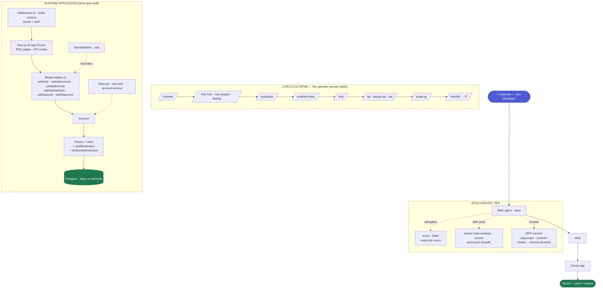
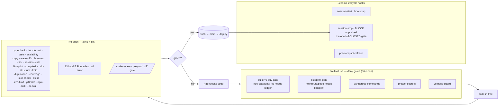

# Architecture — the repo, the harness, and how to operate both

**One map, three former docs.** This file merges `docs/repo-architecture.md` (objectives + the
five-layer product/harness map), `docs/harness-orientation.md` (the eight harness systems +
contributor onboarding, #27), and `docs/token-policy.md` (the operating/cost policy, ADR-019/022).
They restated each other; this is the single map to reason against when improving the template.

**Audience:** anyone about to change the template or the harness — a new maintainer, a contributor,
or the agent orienting at the start of a session.

**Companion docs:** `CLAUDE.md` (the binding constitution) · `docs/REPO-MAP.md` ("where is X",
auto-generated so it cannot drift) · `docs/runbooks/maintainer.md` (how to change a piece _safely_ —
this file tells you what the pieces are; the runbook tells you the procedure) · `docs/decisions/`
(the ADRs, with a status index in `docs/decisions/README.md`).

> **Counts in this file drift.** Where a number matters, prefer the generated source:
> `docs/REPO-MAP.md` for the file map, `ls .claude/skills` for skills, `docs/decisions/README.md`
> for ADRs, `docs/rules/harness.md` for the authoritative `/ship` phase list. Numbers here were
> re-counted on 2026-08-17.

---

## 1. What this repo is

A **prototype rail**: a reusable Next.js starter that lets a _non-developer operator_ turn an idea
into a **secure, quality, shareable live URL** by iterating with Claude — then hand production to an
IT team. It is two products in one repo:

1. **A runtime application template** — the Next.js 16 + Prisma 7 + Auth.js v5 app that gets forked
   and shipped (ADR-001, locked stack).
2. **A harness (an AI-development operating system)** — the skills, hooks, agents, gates, and
   governance in `.claude/` + `scripts/` + `docs/` that make Claude's default behavior _match the
   standard automatically_, instead of relying on the operator to know the rules.

The second is the point. The whole repo exists so that "good practice" is **enforced by the
machine**, not remembered by a human.

## 2. Objectives (what the tooling optimizes for)

Each objective is inferred from the tools built to serve it:

| #      | Objective                                                                                                         | The tools that serve it                                                                                                                                                  |
| ------ | ----------------------------------------------------------------------------------------------------------------- | ------------------------------------------------------------------------------------------------------------------------------------------------------------------------ |
| **O1** | **Idea → shared live URL, fast** (~10 min, non-dev friendly)                                                      | `/quickstart`, `/scaffold-entity`, `/new-project`, `/first-fork`, `/deploy`; Vercel + Neon (ADR-006); push = deploy                                                      |
| **O2** | **A security floor that never bends** — even a throwaway is secure-by-default                                     | 13 local ESLint rules · auth wrappers (`api-helpers`) · audit + soft-delete Prisma extensions · zod boundaries · `protect-secrets`/`dangerous-commands` hooks · gitleaks |
| **O3** | **Quality enforced as gates, not hoped for** — the Five Pillars (speed/secure/maintainable/scalable/high-quality) | `/ship` · `/qa` → `/design-qa` → `/uat` · `findings-register` wave-offs                                                                                                  |
| **O4** | **Enforcement over advice** — convert good-practice prose into machine checkpoints                                | build-vs-buy gate (ADR-032) · blueprint gate (ADR-033) · complexity gate (ADR-034) · ai-eval gate (ADR-036/042, conditional) · tiered gates (ADR-025)                    |
| **O5** | **Cost discipline / token thrift** — the operator iterates cheaply                                                | `scout` (haiku) · `verbose-guard` · model-routing (ADR-022) · `/batch` · §7 of this file                                                                                 |
| **O6** | **Cross-session durability** — ephemeral containers never lose work                                               | `session-stop` hook (hard-block on unpushed) · `/handoff-session` · `agent-memory` · `pre-compact-refresh`                                                               |
| **O7** | **Design quality on the first pass** — non-slop UI without a designer                                             | `/design-system` · shadcn/Radix primitives · `tokens.css` · `no-raw-hex-color` · `uat-rubric`                                                                            |
| **O8** | **Graceful growth + clean exit** — prototype → production without restructuring                                   | `/scale-up` recipes · `/handoff` (to IT) · `/conform` · `/sync-from-template`                                                                                            |

**One sentence:** _make it trivially easy to ship a secure, well-built internal tool, and
structurally hard to ship a bad one._

---

## 3. The five layers

The repo is best understood as five layers. The **operator** drives the top; everything below either
_produces_ the runtime app or _guards_ its production.



### Layer 1 — Lifecycle spine (skills)

The horizontal operator journey: **rebrand → provision → quickstart → scaffold → ship → QA →
scale-up → handoff.** Skills are the verbs. ~32 skills live in `.claude/skills/*/SKILL.md`
(agentskills.io-conformant, gated by `skill-check` / V2-503). About 7 carry a hard internal gate
(`/ship`, `/handoff`, `/design-qa`, `/qa`, `/uat`, `/scaffold-entity`, `/conform`); the rest are
advisory (invoke-when-you-remember), nudged only by the `skill-activation` hook. Discover them via
the skill list — each SKILL.md is self-documenting.

### Layer 2 — Runtime application (the product)

The strict call chain, enforced by lint rules:

`Request → middleware.ts (auth/locale) → App Router (RSC page OR API route) → api-helpers wrapper → service → Prisma (audit + soft-delete) → Postgres`

Invariants (each backed by an ESLint rule and/or a lib primitive):

- **UI never touches Prisma** (`no-prisma-in-client`) — only RSC + API routes do.
- **Every route is auth-wrapped** (`api-helpers`; `no-bare-internal-route`).
- **Rate-limit composes _outside_ auth** (`no-rate-limit-inside-auth`).
- **zod validates at the boundary** before Prisma.
- **Audit + soft-delete are automatic** via Prisma extensions (`prismaUnfiltered` bypasses both —
  allowlisted).
- **No raw/unsafe SQL, no secret logging, no off-token colors, no unaudited bulk writes, no secret
  export columns, no off-scale arbitrary classNames, no untranslated JSX literals** (the remaining
  rules; full roster in `docs/rules/harness.md`).

### Layer 3 — Enforcement mesh (the guards that wrap everything)

This is the layer that makes objectives O2–O4 real. It wraps _both_ the agent's actions and the
code's push path.



**The honest caveat** (from the audit): every PreToolUse guard is **fail-open** — if the hook errors,
the action is allowed — except `protect-secrets` and `dangerous-commands`, which fail **closed**.
Only `session-stop` fails closed on the push path. And the write gates fire on **added files only**,
blind to `Edit`-driven sprawl.

### Layer 4 — Intelligence tier (who does the work)

- **Main agent (opus)** — drives everything.
- **scout (haiku)** — cheap read-only recon; keeps big reads out of the expensive window (O5).
- **senior-code-reviewer (sonnet)** — post-push breadth review (dormant in CI until funded →
  currently invoke-on-demand).
- **security-architect (opus)** — security-architecture / threat-model / trust-boundary /
  data-classification design review (ADR-022 hardest tier).
- **sre (sonnet)** — operational-readiness / observability / runbook / deploy-rollback review.
- **MCP servers** — `playwright` (drives `/design-qa`, `/uat`), `context7` (live docs), `shadcn`
  (component scaffolding for the current stack), `chrome-devtools` (perf; not yet wired to a skill).

### Layer 5 — Knowledge & governance (the rules of record)

The layer everything else answers to — read at SessionStart, enforced by the gates:

`CLAUDE.md` (binding rules) · **61 ADRs** (decisions of record; 4 are enforcement gates — see
`docs/decisions/README.md` for the status index) · `SECURITY.md` (data classes, threat model) ·
`docs/uat-rubric.md` (the Five Pillars) · this file §7 (token policy, O5) · `docs/agent-memory.md`
(durable cross-session knowledge, O6) · `docs/findings-register.md` (adjudicated wave-offs) ·
`docs/build-vs-buy-ledger.md` + `docs/blueprints/*` (the artifacts the write gates check for).

---

## 4. The eight harness systems (and how they connect)

The five layers say what exists; these eight say how the _harness_ half is wired. The harness is the
`.claude/` tree + the `/ship` gates + the ADR/ledger/register docs.

1. **The constitution + lazy rules.** `CLAUDE.md` is the always-on binding law (≤8 KB — the context
   budget, V2-101). Domain detail lives in `docs/rules/*.md`, loaded **lazily** when you touch a
   matching path (a `rules-injection` hook surfaces the right file on an edit). → _Read the rule file
   for the area before you change it._

2. **The enforcement quartet.** Four gates, enforced at TWO different moments (mirroring `CLAUDE.md`'s
   "denied/RED" wording): **two PreToolUse hooks DENY at write time** — **build-vs-buy** (ADR-032 →
   a `docs/build-vs-buy-ledger.md` entry with a `Considered:` line) and **blueprint** (ADR-033 → a
   `docs/blueprints/*.md` with a covering `Scope:`) block the Write/Bash outright until the artifact
   exists (`bash-write-gate` covers shell writes too). **Two more turn `/ship` RED after the fact** —
   **complexity** (ADR-034 → `/ship`'s phase-A budget check on the diff; a `complexityAck` waiver +
   register line clears it) and **ai-eval** (ADR-036/042 — conditional: it reports `inert` on a fork
   with no AI rail, and enforces the moment one sets `AI_API_KEY` + writes eval fixtures). → _A new
   `lib/**`, `components/shared/**`, `scripts/**`, `app/api/**/route.ts`, or `app/**/page.tsx` file
   is DENIED at write without its ledger/blueprint entry; an over-budget file WRITES but reds
   `/ship`._

3. **`/ship` — the active gate.** `npm run ship` (warm, DB-free) is what makes a push allowed (a
   `Stop`/pre-push hook enforces it). Its phase-A list is the authoritative one in
   `docs/rules/harness.md`; `scripts/ship.mjs` prints it on every run. **`ship:full`**
   (`npm run ship:full` / `SHIP_FULL=1`) adds the docker image build + trivy scan (ADR-030) and the
   integration suite against a real Postgres (ADR-061). CI is dormant on the free plan, so `/ship`
   _is_ CI. → _Never land red; the warm loop stays fast because DB/app/docker work lives in
   `ship:full`._

4. **The tool-time hooks.** Beyond the gate quartet: **`protect-secrets`** (fail-closed — denies
   reading OR writing real secret material, incl. Bash/Write/Edit/MultiEdit), **`dangerous-commands`**
   (fail-closed — the semantic backstop under the lexical deny-list), **`skill-activation`** (advisory
   — suggests a skill by keyword/path), **`rules-injection`** (surfaces the lazy rule file). → _Hooks
   are the runtime floor; loosening one is security-sensitive (runbook + a register line)._

5. **The skills lifecycle.** See Layer 1 above — idea→URL through `/quickstart`, `/blueprint`,
   `/scaffold-entity`, `/design-system`, `/ship`, `/qa`, `/uat`, `/deploy`, `/handoff`, plus the
   harness tools (`/fan-out`, `/adopt`, `/retro`, `/docs-current`, …).

6. **The review rail (two-stage).** Before a push touching auth/schemas/API/`lib/`: `/code-review`
   (pre-push diff gate). After every code push: the **`senior-code-reviewer`** agent (breadth). Both
   run **Stage 1 spec-compliance before Stage 2 quality** (V2-206). → _Route work to the model tier
   that fits (ADR-022, §7); the review rail is where the Phase-4/5 real bugs were caught._

7. **The decision + finding records.** **ADRs** (`docs/decisions/`, MADR template via `/adr`) are the
   architectural law; changing the ADR-001 locked stack needs a _superseding_ ADR (never an in-place
   edit — see `docs/decisions/README.md`). The **build-vs-buy ledger** records every build-vs-adopt
   call **and is a live gate input**, not just history. The **findings register**
   (`docs/findings-register.md`) holds wave-offs/adjudications (operator-only to flip); its resolved
   history is at `docs/archive/findings-register-2026.md`. **SECURITY.md** is the security reference.
   → _Decisions go in an ADR, not chat; wave-offs go in the register, not silence._

8. **The memory lifecycle.** Durable cross-session knowledge → `docs/agent-memory.md` (reaches
   `main`, inherited by forks, add via `/remember`). In-flight state → `docs/session-state.json` +
   `docs/SESSION-HANDOFF.md` (**gitignored, local to the machine, never committed** since
   2026-07-25; SessionStart regenerates a skeleton when absent). → _What the next session must not
   rediscover goes in agent-memory — a commit of the session-state files is not the answer._

---

## 5. How a single change flows

Compressed:

```
idea → /blueprint (contract) → build (gate quartet allows the files) → /ship green
     → push (pre-push /ship) → senior-code-reviewer (post-push) → fix findings
     → land on main → /remember durable lessons
```

Expanded, layer by layer:

1. Operator prompts the **main agent** → the prompt passes `UserPromptSubmit` hooks
   (`skill-activation` suggests). _(L4 + L3)_
2. Agent picks a **skill** from the lifecycle spine (e.g. `/scaffold-entity`), possibly delegating
   recon to **scout**. _(L1 + L4)_
3. Agent writes code → each tool call passes **PreToolUse deny gates** (build-vs-buy, blueprint,
   etc.). _(L3)_
4. Code lands in the **runtime app** along the enforced call chain, satisfying the **ESLint
   invariants**. _(L2)_
5. Before push: **`/code-review`**, then **`/ship`** must be green; the change is judged against the
   **Five Pillars** in `docs/uat-rubric.md`. _(L3 + L5)_
6. Push → Vercel deploys; **`senior-code-reviewer`** does the breadth pass. _(L4)_
7. **`session-stop`** blocks the turn from ending with unpushed work; durable knowledge goes to
   **`agent-memory`**. _(L3 + L5 + O6)_

Each arrow is enforced, not optional: the gate quartet blocks an unplanned file, `/ship` blocks a red
push, the review rail catches what the diff gate misses, and `main` only ever carries green work.
Every arrow is governed by **CLAUDE.md + the ADRs** (L5). That is the whole machine.

---

## 6. Contributor onboarding — your first safe change

1. **Read:** `CLAUDE.md` (skim all; internalize the Hard rules + Ask-before list), this file, and the
   `docs/rules/*.md` for the area you'll touch.
2. **Pick something small** that is NOT on the Ask-before surface (avoid `lib/auth.ts`,
   `middleware.ts`, `eslint-rules/**`, `lib/prisma/**`, `.claude/settings.json` permissions to start).
3. **Follow the runbook** (`docs/runbooks/maintainer.md`) for the exact procedure for your change type
   (an ESLint rule, a hook, a `/ship` gate, an ADR, a dependency).
4. **Gate it:** `npm run ship` green. If you touched a hook/rule, `npm run test:hooks` /
   `test:lint-rules` too.
5. **Get it reviewed:** run `/code-review` on the diff; after pushing, the `senior-code-reviewer`
   agent — resolve its findings before calling it done.
6. **Land green on `main`;** record any durable lesson via `/remember`.

If you're unsure whether a change is high-blast-radius or on the Ask-before surface: **stop and ask
the operator.** Tightening the floor is cheap; loosening it needs a human decision on the record.

---

## 7. Token policy — operating Claude Code without burning the budget

Research-backed (ADR-019; sources: code.claude.com/docs/en/costs, /best-practices, /context-window,
/large-codebases; community-measured repos; enterprise rollouts). The repo side is already enforced
by this template; the session habits are the operator's half of the contract.

### 7a. Repo side (enforced by this template)

1. **CLAUDE.md ≤ ~200 lines.** It is loaded every session and re-sent after every compaction; every
   line is a permanent tax AND dilutes instruction-following ("bloated CLAUDE.md files cause Claude
   to ignore your actual instructions" — Anthropic). Details live behind pointers: `docs/recipes.md`,
   skill SKILL.mds, ADRs. When adding to CLAUDE.md ask: "would removing this cause mistakes?" If not,
   it goes in a doc/skill instead.
2. **Quiet gates.** `npm run ship` prints ~12 lines, not thousands — verbose test/build output is the
   #1 in-session token sink (Anthropic's own example: 10k-line log → hundreds of tokens). Never run
   the full suite raw when the gate script exists; never tail a dev server in foreground.
   - **Reserve `--full` for the moments that need it.** `npm run ship:full` (`--full` / `SHIP_FULL=1`)
     adds the ADR-030 docker image-build + trivy scan and the integration suite (wall-time + a
     longer, noisier log than the fast loop). It belongs at `/deploy`, `/handoff`, and CI — not on
     every push. The default `npm run ship` stays image-free so
     the tight iteration loop (and its token cost) is unchanged; a WARN-degrade when Docker is
     unavailable keeps the full loop from failing on daemon-less machines.
3. **Read-deny on bulk artifacts.** `.claude/settings.json` denies Read on `.next/`, `node_modules/`,
   `generated/` so a stray search can't pull a 600KB minified chunk or the generated Prisma client
   into context.
4. **Skills = progressive disclosure.** Workflow knowledge lives in `.claude/skills/*/SKILL.md`,
   loaded only when invoked — never inline in CLAUDE.md.

### 7b. Session habits (the operator's half — biggest levers first)

1. **One task per session; `/clear` between tasks.** After 2 failed corrections, `/clear` and
   re-prompt with what you learned — "a clean session with a better prompt almost always outperforms
   a long session with accumulated corrections."
2. **Prune MCP servers** (`/mcp`, check `/context`). Community-measured: up to ~67k tokens of tool
   schemas before your first prompt; one search server alone was 14k. Prefer CLIs (`gh`, `vercel`)
   over MCP equivalents. (SessionStart warns when >3 servers are configured — see `docs/mcp.md`.)
3. **Model tiering.** Sonnet by default; Opus/Fable only for architecture-grade work; `model: haiku`
   for simple subagents. Thinking tokens bill as output — lower `/effort` or set
   `MAX_THINKING_TOKENS` for routine sessions. (Formalized in §7c.)
4. **Subagents for exploration.** "Investigate X with a subagent" keeps hundreds of file-reads out of
   the main window; only the summary returns. Avoid the named failure mode: unscoped "explore the
   codebase".
5. **Specific prompts.** "Add zod validation to POST /api/users in app/api/users/route.ts" — not
   "improve validation". Vague prompts buy repo-wide scanning.
6. **`/compact <instructions>` proactively** at natural milestones (after a green ship), not when
   forced at the limit; `/btw` for side questions (never enters history); save plans/specs to files —
   files survive compaction, history may not.
7. **Don't break the prompt cache.** Cache reads are 0.1x price; changing settings/MCP set/system
   content mid-session invalidates the cached prefix. Keep CLAUDE.md stable within a working day.
8. **Watch the meter.** `/usage` (per-session + 7d attribution), `/usage-credits`, `/context` (live
   breakdown); `npm run tokens` (ccusage) for local session reports. Anthropic baseline:
   ~$13/dev/active-day average, 90% < $30.
9. **Plan mode economics.** Use it for multi-file work (prevents expensive re-work); skip it when you
   could describe the diff in one sentence — plan mode itself costs overhead.
10. **Headless for batch.** Repetitive migrations: `claude -p` per file with `--allowedTools` and
    `--max-turns` — fresh minimal context each run beats one giant session (Airbnb's 3.5k-file
    migration pattern: cheap capped retries, validation gates in the loop). `/batch` wraps this.

### 7c. Model-routing tiers (ADR-022)

Route work to the cheapest model that can do it well. This is the formalized version of habit #3
above — guidance, not an auto-router (a metric with no real token accounting behind it is theater;
see ADR-022). Enforcement points are subagent `model:` frontmatter and your per-session `/model`
choice.

| Tier      | Model            | Route here                                                                                                                                                            | Mechanism / where                                               |
| --------- | ---------------- | --------------------------------------------------------------------------------------------------------------------------------------------------------------------- | --------------------------------------------------------------- |
| **Cheap** | `haiku`          | repo-wide search, "where is X / how does Y work", orientation passes, reading >5 files, repetitive codemods, scaffold lookups                                         | `scout` agent (`model: haiku`); `/batch` headless per-file runs |
| **Mid**   | `sonnet`         | functional single-/few-file edits, post-push review breadth, moderate multi-file work                                                                                 | default working model; `senior-code-reviewer` (`model: sonnet`) |
| **Top**   | `opus` / `fable` | architecture & design, ambiguous/high-blast-radius work, anything on the Ask-before surface (auth, `lib/`, schema, migrations, `middleware.ts`), spec/plan authorship | `/model opus` (or fable) for that session only                  |

Rules of thumb: **delegate down before working up** — push exploration to `scout` and batch jobs to
`/batch` so the top-tier session spends its context on judgment, not file-reads. Don't pin a
project-wide default model (ADR-019): your account / `/model` choice stands; only subagents tier down
in their definitions. When a session is purely mechanical, drop yourself to `/model sonnet` and let
`scout` carry the haiku-tier reads.

### 7d. Automation shipped (ADR-019) — what the harness does for you

| Concern                      | Mechanism                                                                                                                                                                          |
| ---------------------------- | ---------------------------------------------------------------------------------------------------------------------------------------------------------------------------------- |
| Know the burn live           | statusline: `model \| ctx % \| msgs \| $` (`.claude/statusline.mjs`)                                                                                                               |
| Detect when to start fresh   | statusline `ctx %` + judgment — run `/handoff-session` when a session gets long (the automated context-watchdog was removed 2026-07-16)                                            |
| Hand off cheaply             | `/handoff-session` prints the full handoff to paste and writes `docs/SESSION-HANDOFF.md` locally (gitignored since 2026-07-25 — the printed copy is the carrier across containers) |
| Stop token-bomb commands     | PreToolUse guard denies raw `npm test`/build/dev-server with the quiet alternative (override: prefix `VERBOSE=1`)                                                                  |
| Cheap exploration            | `scout` agent (haiku, read-only, ≤30-line reports)                                                                                                                                 |
| Durable cross-session memory | `docs/agent-memory.md` surfaced at SessionStart (≤30-line digest, sections on demand), written via `/remember` + `/handoff-session` promotion (ADR-022)                            |
| Model routing                | tier table above (haiku/sonnet/opus) — guidance + subagent frontmatter, no auto-router (ADR-022)                                                                                   |
| O(1) orientation             | `docs/REPO-MAP.md`, auto-refreshed by SessionStart when stale                                                                                                                      |
| Batch jobs                   | `/batch` — headless per-file runs, capped turns/retries, cost logged                                                                                                               |
| Per-session accounting       | SessionEnd receipt → `.claude/usage-log.jsonl`                                                                                                                                     |
| Model choice                 | NO forced project default — your account/`/model` choice stands. Subagents still tier down (scout = haiku). Drop to `/model sonnet` yourself for mechanical sessions.              |
| MCP overload                 | SessionStart warns when >3 servers configured                                                                                                                                      |

### 7e. Operator-only (one-time / per-session, cannot be automated from the repo)

| Action                   | How                                                                 |
| ------------------------ | ------------------------------------------------------------------- |
| Prune MCP servers        | `/mcp` → disable unused (check `/context` first)                    |
| Monthly hard cap         | `/usage-credits` → set limit                                        |
| Architecture-day model   | `/model opus` (or fable) for that session only                      |
| Side questions           | `/btw` (never enters history)                                       |
| Thinking budget (opt-in) | `MAX_THINKING_TOKENS=8000` env for mechanical sessions — NOT global |
| Code-intelligence plugin | install an LSP plugin once: go-to-def replaces grep+reads           |
| Weekly review            | `/usage` + `.claude/usage-log.jsonl` (or `npm run tokens`)          |
