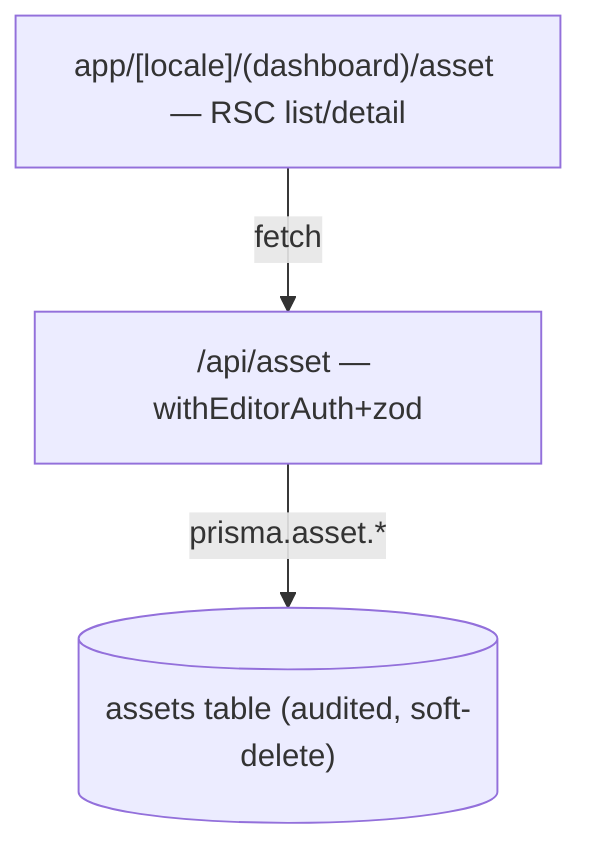

# Blueprint — IT Asset Tracker (Phase-2 pilot, V2-210)

Scope: app/api/asset/**, app/**/asset/**, components/asset/**, lib/validations/asset.ts, app/api/category/**, app/**/category/**, components/category/**, lib/validations/category.ts, app/api/manufacturer/**, app/**/manufacturer/**, components/manufacturer/**, lib/validations/manufacturer.ts, app/api/asset-model/**, app/**/asset-model/**, components/asset-model/**, lib/validations/asset-model.ts, lib/csv.ts

BDD: tests/features/asset-tracker.feature

Track: **Full** · Pilot feature for harness-v2 Phase 2 (proves the loop end-to-end).

## Problem & outcome

A fleet admin needs to account for IT hardware (laptops, monitors, phones) with an audit trail and
role-gated writes. When this ships, assets are a first-class, searchable, audited register instead
of a spreadsheet. This feature exists to **exercise every loop station** (benchmark → explore →
blueprint → implement → review → ship → retro); it is intentionally a table-stakes slice, not a
full ITAM suite.

## Market scan

`docs/benchmarks/it-asset-management.md` (produced by `/benchmark`) mined Snipe-IT (OSS) + GLPI +
ServiceNow ITAM + Asset Panda. Build-vs-adopt: no same-stack (Next 16 + Prisma) OSS fits; the
template's `/scaffold-entity` is the closest same-stack path (ADR-059).

## Feature parity (dispositions the ITAM table-stakes — V2-202)

| Benchmark row (table-stakes)      | Disposition  | Pointer                                                                 |
| --------------------------------- | ------------ | ----------------------------------------------------------------------- |
| T1 Unique asset tag               | IN           | → US1 / `assetTag` unique+immutable                                     |
| T2 Model→Category→Manufacturer    | IN           | → `Category`/`Manufacturer`/`AssetModel` + `Asset.modelId` (2026-07-18) |
| T3 Status/state labels            | IN           | → US4 `status` enum + transition rule                                   |
| T4 Assignee / location            | IN (partial) | → `assignee → User?` (location deferred)                                |
| T5 Check-out / check-in           | IN           | → US4 status transitions (ASSIGNED)                                     |
| T6 Purchase & warranty fields     | IN (partial) | → `purchasedAt` (warranty deferred)                                     |
| T7 Depreciation                   | N/A          | out of pilot scope (reporting concern, not the CRUD slice)              |
| T8 Full audit history             | IN           | → auditExtension (auto, app-floor)                                      |
| T9 Custom fields                  | DEFERRED     | → findings-register (fieldset model is a later scale-up)                |
| T10 Search + filter + list export | IN           | → shared DataTable (app-floor)                                          |
| T11 Bulk import (CSV)             | DEFERRED     | → findings-register (`/scale-up` import recipe)                         |
| T12 Role-based access             | IN           | → US2 `withEditorAuth` on writes                                        |

(DEFERRED rows are tracked in `docs/findings-register.md`; anti-features A1–A5 from the benchmark —
ticketing, ITIL, MDM, ledger, procurement — are explicitly OUT to keep the pilot an asset register.)

## Tier

`personal` (matches `project.config.json`). No change to the security floor.

## User stories (stable IDs — the traceability spine)

- **US1** — As a fleet admin, I want to create and list assets, so that hardware is registered.
  - **AC-1.1** — WHEN an editor POSTs a valid asset THE SYSTEM SHALL persist it (audited) and return it.
  - **AC-1.2** — WHEN listing assets THE SYSTEM SHALL return a bounded (paginated) result set.
- **US2** — As a security owner, I want writes role-gated, so that viewers can't mutate the register.
  - **AC-2.1** — IF a VIEWER attempts a write THEN THE SYSTEM SHALL reject with 403 and no write.
- **US3** — As a fleet admin, I want invalid input rejected clearly, so that bad data never lands.
  - **AC-3.1** — IF `assetTag` is blank THEN THE SYSTEM SHALL reject with the zod message (not a 500).
- **US4** — As a fleet admin, I want legal status transitions enforced, so that lifecycle is coherent.
  - **AC-4.1** — IF a status change is not a legal move (e.g. RETIRED→ASSIGNED) THEN THE SYSTEM SHALL
    reject with a 400 (the app-wide convention) zod message.

## Scenarios (per story; worst path mandatory)

- **US1-happy** — Given an ADMIN session + valid data, When POST /api/asset, Then created + audited + listed.
- **US2-worst** — Given a VIEWER session, When POST /api/asset, Then 403, no row written.
- **US3-worst** — Given an editor + blank `assetTag`, When POST /api/asset, Then the zod message, not a 500.
- **US4-worst** — Given an asset in RETIRED, When PUT status→ASSIGNED, Then 400 (illegal transition — app-wide err() convention).

## Delta — was → now

- 2026-07-17 (pilot): n/a — additive only (new entity, new routes; no existing behavior changes).
- **2026-07-18 (repo-audit, V2-209 amendment): graduate the pilot from flat register to real ITAM.**
  Operator directive "do all now" authorized building the three DEFERRED table-stakes rows:
  - **T2 hierarchy** — was: `category` flat enum. now: real `Category` + `Manufacturer` + `AssetModel`
    entities (full CRUD, soft-delete, audit); `Asset` gains a nullable `modelId → AssetModel` (the
    enum column is RETAINED this release for forward-compat — never drop a column the running version
    reads). Form category `Select` → cascading Category→Manufacturer→Model `RelationSelect`s.
  - **T9 custom fields** — was: fixed columns only. now: `CustomFieldDef` entity (label/key/type/
    required) + a `customFields Json?` column on `Asset`; the form renders defs dynamically and the
    boundary validates them.
  - **T11 bulk CSV import** — was: none. now: `POST /api/asset/import` (editor-auth, rate-limited)
    doing per-row **audited** `create` inside a `$transaction` (NOT `createMany` — ADR-010) + a bounded
    row cap + per-row error report; a list-page import panel with preview.
    Additive migrations only; each sub-phase re-confirmed below.

## Universal app-floor checklist (V2-203)

- Per list: search `[x]` · filter `[x]` · sort `[x]` · saved views `N/A` (pilot) · pagination `[x]` ·
  export `[x]` · bulk actions `[~]` (deferred) · empty state `[x]` — all via the shared `DataTable`.
- Per entity: detail `[x]` · edit `[x]` · audit `[x]` (auditExtension) · delete/restore `[x]` (soft-delete + recycling bin).
- Per app: nav `[x]` (scaffold adds sidebar link) · notifications `N/A` · settings `N/A` · help/onboarding `N/A` · activity `[x]` (audit feed).

## Domain model

| Entity  | Key attributes                                                                               | Restricted? | Enums                                                                                    | Relationships            |
| ------- | -------------------------------------------------------------------------------------------- | ----------- | ---------------------------------------------------------------------------------------- | ------------------------ |
| `Asset` | `assetTag:string!` (unique, immutable), `name:string`, `serial:string?`, `purchasedAt:date?` | no          | `status: IN_STOCK\|ASSIGNED\|REPAIR\|RETIRED`, `category: LAPTOP\|MONITOR\|PHONE\|OTHER` | `assignee → User? (N:1)` |

- **Invariants:** `assetTag` unique + immutable after create; legal status moves
  IN_STOCK↔ASSIGNED, IN_STOCK→REPAIR→IN_STOCK, any→RETIRED (terminal); RETIRED has no outgoing moves.
  Writes = `editor` (ADMIN|EDITOR). Audited + soft-delete (scaffold wires both). Reuses `User`.

## Architecture sketch

- `GET/POST /api/asset`, `GET/PUT/DELETE /api/asset/[id]` — `withAuth` read, `withEditorAuth`
  write, `withRateLimit` outside; the API route is the server boundary that calls `prisma.asset.*`
  directly (the template's route-is-the-service convention — server routes may touch Prisma) →
  `assets` table (`@@map`). No separate `lib/services` layer.
- List bounded (`take`/`where` via `parsePagination`) — Scalable. Reuses shared `DataTable`, audit +
  soft-delete extensions, recycling-bin registration. Built via `/scaffold-entity` (singular `asset`
  path convention); the status-transition rule is a hand-added zod refinement (ADR-059).

## The five pillars

- Speed — RSC + bounded list; scaffolded in one command. Maintainable — reuses every shared primitive.
- Scalable — list paginates; no N+1. Secure — auth wrappers + zod on every route; audited; no Restricted fields.
- High-Quality — honest empty/loading/error states from the shared primitives; worst-path scenarios cover RBAC + validation + illegal transition.

## Work-graph DAG (V2-205)

| #   | Task (story)                 | P/S         | File-ownership set                                                                                    | Role-lens  |
| --- | ---------------------------- | ----------- | ----------------------------------------------------------------------------------------------------- | ---------- |
| 1   | scaffold Asset (US1-US3)     | [S]         | `prisma/**`, `lib/validations/asset.ts`, `app/api/asset/**`, `app/**/asset/**`, `components/asset/**` | api + auth |
| 2   | status-transition rule (US4) | [S] after 1 | `lib/validations/asset.ts`, `app/api/asset/**`                                                        | api        |
| 3   | .feature + steps (US1-US4)   | [S] after 1 | `tests/features/**`                                                                                   | testing    |

(Scaffold touches many shared files at once → a single `[S]` unit, not a parallel wave — the DAG
correctly serializes it; the parallel-wave demonstration for this program was Wave 1, V2-201/204/208.)

## Open questions (resolved)

- [x] Build approach → `/scaffold-entity` + hand-added transition rule (ADR-059).
- [x] Depreciation/custom-fields/bulk-import → DEFERRED to findings-register (out of pilot slice).

Confirmed: Tariq Al-Naaimi 2026-07-18 (operator directive "do all now" re-confirms the amended blueprint — the T2/T9/T11 graduation build-out authorized in the repo-audit session; 2026-07-17 pilot confirmation superseded).
