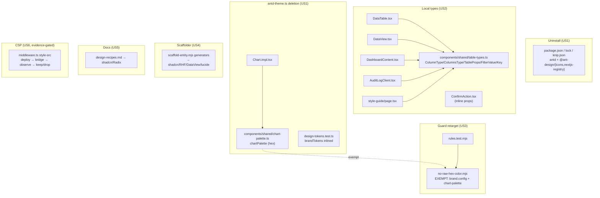

# Blueprint — C4: Harness/Guard AntD Cleanup (final AntD removal)

_Program: replatform-and-adoption · workstream C4 · ADR-029 · branch
`claude/ui-replatform-auto-spawn-fix-8dee0o`. Prereq C3.5 (adb155e) is done:
runtime AntD is gone from `app/**` + `components/**`; only type-only bridges +
`antd-theme.ts` type import + the scaffold generator's emitted AntD remain._

## Problem & outcome
AntD (`antd`, `@ant-design/icons`, `@ant-design/nextjs-registry`) is still a
runtime **dependency** of the template even though no shipped screen renders it.
Six seams keep it installed: (a) type-only `Table`/`Popconfirm` bridges; (b)
`components/layout/antd-theme.ts` (still the home of `chartPalette`/`brandTokens`
+ dead `buildTheme`); (c) a CSP `style-src 'unsafe-inline'` exception commented as
"for AntD"; (d) the `no-raw-hex-color` rule exempting `antd-theme.ts`; (e)
`docs/design-recipes.md` written against AntD; (f) **`scripts/scaffold-entity.mjs`
still generates AntD columns/forms/pages**. When C4 lands, `git grep antd` returns
nothing in shipped code/config, the dependency is uninstalled, the design docs and
the scaffolder describe/emit the shadcn/Radix stack, and D3 ("replace AntD fully")
is finally true. Outcome for the operator: a clean single-UI-stack template; forks
inherit zero AntD and a scaffolder that generates working code.

## Market scan
n/a — this is the terminal cleanup of an already-decided migration (ADR-029, which
did the market benchmark: shadcn/ui + Radix + TanStack Table over AntD 6). No new
library is introduced; C4 only *removes*. The one net-new file (`chart-palette.ts`)
is a relocation of existing constants, not an adoption.

## Tier
`personal` (template default; `project.config.json`). C4 changes ceremony none —
it touches the Ask-before surface (`eslint-rules/`, `middleware.ts`) so it runs the
full blueprint + plan gate, but adds no route, no migration, no Restricted field.

## User stories (stable IDs — the traceability spine)
- **US1** — As the template maintainer, I want AntD fully uninstalled, so that the
  template ships one UI stack and no dead 2 MB dependency.
  - **AC-1.1** — WHEN `/ship` runs after C4, THE SYSTEM SHALL pass typecheck, lint,
    contract tests, component tests, build, knip, and gitleaks with `antd`,
    `@ant-design/icons`, `@ant-design/nextjs-registry` absent from `package.json`,
    `package-lock.json`, and `knip.json` `ignoreDependencies`.
  - **AC-1.2** — IF any source or test file still imports `antd`/`@ant-design/*`
    (runtime OR type-only) after C4, THEN typecheck SHALL fail — so the removal is
    verified by the compiler, not by eye.
- **US2** — As a developer consuming `DataTable`/`DataView`/`ConfirmAction`, I want
  their public prop APIs unchanged, so that every existing call site compiles and
  behaves identically after the AntD types are dropped.
  - **AC-2.1** — WHEN the type-only AntD bridges are replaced by the local
    `table-types` module, THE SYSTEM SHALL keep the exported `DataTableProps`/
    `DataViewProps`/`ConfirmActionProps` shapes structurally identical (columns,
    dataSource, rowKey, loading, rowSelection, scroll, size, pagination, filters,
    okType, etc.), verified by the unchanged `tests/components/DataTable.test.tsx`
    passing green.
- **US3** — As the design-system guardrail, I want `no-raw-hex-color` retargeted
  off the deleted `antd-theme.ts`, so that the rule still names a real sanctioned
  hex source and still flags stray hex in components.
  - **AC-3.1** — WHEN a raw hex literal appears in a non-exempt component after C4,
    THE SYSTEM SHALL flag it; the exempt set SHALL be `brand.config.ts`,
    `tokens.css` (out of ESLint scope anyway), and the new `chart-palette.ts` —
    NOT `antd-theme.ts`.
  - **AC-3.2** — WHEN `tests/eslint-rules/rules.test.mjs` runs, THE SYSTEM SHALL
    exercise the retargeted exempt path (chart-palette) and pass.
- **US4** — As a fork operator running `/scaffold-entity` after C4, I want the
  generated entity to build, so that scaffolding isn't silently broken by the AntD
  uninstall.
  - **AC-4.1** — WHEN `npm run scaffold` generates a columns file, a form, and a
    page, THE SYSTEM SHALL emit shadcn/RHF/DataView code (no `from "antd"`, no
    `@ant-design/icons`) that typechecks against the migrated primitives.
- **US5** — As a developer reading `docs/design-recipes.md`, I want the patterns to
  match the shipped primitives, so that copy-paste produces on-stack code.
  - **AC-5.1** — WHEN design-recipes.md is followed after C4, THE SYSTEM SHALL
    describe `components/ui/*` + `components/shared/*` (shadcn/Radix/RHF/TanStack),
    with zero `antd`/`theme.useToken()`/`antd-theme.ts` references in live guidance.
- **US6** — As the security posture, I want the CSP `style-src` decision made on
  evidence, so that we neither ship a stale-reason exception nor break overlays.
  - **AC-6.1** — WHEN the branch is deployed with `style-src 'unsafe-inline'`
    removed and loaded through the design-qa bridge, THE SYSTEM SHALL be observed
    for `Refused to apply inline style` CSP violations; IF any occur THEN the
    exception SHALL be kept with a corrected (Radix/recharts/dnd-kit/sonner)
    comment, ELSE it SHALL be dropped.

## Scenarios (Given/When/Then — worst path mandatory)
- **US1-happy** — Given C4's edits are complete, When `/ship` runs, Then all 17
  phases pass with AntD absent (AC-1.1).
- **US1-worst** — Given a missed type-only import (e.g. a leftover
  `antd/es/table`), When typecheck runs, Then it fails with "Cannot find module
  'antd'" — the removal is compiler-verified, not assumed (AC-1.2).
- **US2-happy** — Given the local `table-types` module, When `DataTable.test.tsx`
  renders rows/empty/search/pager, Then all five cases pass unchanged (AC-2.1).
- **US2-worst** — Given a call site passing a full AntD-shaped column
  (`sorter`/`filters`/`filterMultiple`/`align`/`ellipsis`/`width`), When it
  compiles against the local types, Then it typechecks with no `any` and renders
  identically (no dropped prop).
- **US3-worst** — Given `chart-palette.ts` holding the hex array, When lint runs,
  Then no-raw-hex does NOT flag it (exempt) but DOES still flag a hex dropped into
  any other component (AC-3.1) and the rule test passes (AC-3.2).
- **US4-worst** — Given a fork runs `npm run scaffold -- --name Widget --fields
  'name:string'` after the uninstall, When it builds the generated screen, Then it
  compiles (no antd import) — not a red build (AC-4.1).
- **US6-worst** — Given the exception is removed and Radix/recharts overlays load,
  When the console shows inline-style CSP violations, Then the exception is
  restored with the correct comment — the app is NOT shipped with broken overlay
  positioning (AC-6.1).

## Delta — was → now
| Surface | Was | Now | Who notices the break? |
|---|---|---|---|
| `package.json` deps | `antd`, `@ant-design/icons`, `@ant-design/nextjs-registry` present | all three removed | anyone importing antd (compiler catches) |
| `components/shared/{DataTable,DataView,ConfirmAction}.tsx` | types from `antd`/`antd/es/table` | types from local `components/shared/table-types.ts` (+ inline ConfirmAction props) | call sites — but prop shapes preserved (AC-2.1) |
| `components/dashboard/DashboardContent.tsx`, `app/[locale]/(dashboard)/{audit-log/AuditLogClient,style-guide/page}.tsx` | `ColumnsType` from `antd/es/table` | `ColumnsType` from local `table-types` | none (structural parity) |
| `components/layout/antd-theme.ts` | exports `brandTokens`, `chartPalette`, `buildTheme` | **deleted**; `chartPalette` → `components/shared/chart-palette.ts`, `brandTokens` → inlined in `design-tokens.test.ts`, `buildTheme` deleted (dead) | `Chart.impl.tsx`, `design-tokens.test.ts` (repointed) |
| `middleware.ts` CSP `style-src` | `'unsafe-inline'` "for AntD 6 + emotion" | evidence-decided (AC-6.1): kept w/ corrected comment OR dropped | browser overlay/chart/toast rendering |
| `eslint-rules/rules/no-raw-hex-color.mjs` | exempts `antd-theme.ts` + `brand.config.ts` | exempts `brand.config.ts` + `chart-palette.ts`; docs/messages point at `tokens.css`/@theme | anyone dropping hex (behavior preserved) |
| `scripts/scaffold-entity.mjs` generators | emit AntD `Button/Space/Form/Input/Select` + `ColumnsType` + `@ant-design/icons` | emit shadcn `Button` + RHF `FormField`/`form` + `DataView`/local `ColumnsType` + lucide icons | fork operators running `/scaffold-entity` |
| `docs/design-recipes.md` | AntD patterns | shadcn/Radix/RHF/TanStack patterns | developers copy-pasting |
| `tests/components/_render.tsx` | wraps in antd `ConfigProvider`/`App` | wraps in next-intl + react-query only (+ sonner `<Toaster/>` if a tested comp needs it) | component tests |
| `tests/components/PageHeader.test.tsx` | antd `<Button type="primary">` fixture | shadcn `<Button>` fixture | that test only |

## Domain model
n/a — C4 is a build/harness/presentation-layer refactor. It **adds and changes no
Prisma entity**. The `DataTable`/`DataView` it retypes render the existing models
(`User`, `AuditLog`, recycling-bin entities, etc.) unchanged; no read/write path,
migration, or Restricted field is touched (ADR-031: naming the existing models it
reads is the correct path for a stateless refactor — no `dbAck` needed since no
data surface changes at all).

## Architecture sketch
No routes, services, migrations, or state changes. The change graph is
type/config/docs/codegen only:

**Reuse check:** `chart-palette.ts` is the ONLY new file; it inherits the exact
"chart-hex token source" role `antd-theme.ts` held (so the rule exempts it, same as
it exempted antd-theme). The local `table-types.ts` reuses TanStack's own types
where possible and only defines the AntD-column-shaped subset the bridges consume —
it does not reinvent a table. The scaffold generators mirror the already-migrated
`components/users/UserColumns.tsx` (antd-free) + `UserForm.tsx` (RHF) as their
templates — not a new pattern.

## The five pillars
- **Speed** — Removing antd (~2 MB + its emotion runtime) shrinks the dependency
  graph and the install; no runtime path changes. n/a for request latency.
- **Maintainable** — Kills the last AntD coupling: one UI stack, one token source,
  a scaffolder that emits the same primitives the app uses. Deletes dead
  `buildTheme`. This is the pillar C4 most serves.
- **Scalable** — n/a (no data/query path touched).
- **Secure** — CSP decision is made on **evidence** (AC-6.1), not left as a
  stale-reason exception; the `no-raw-hex-color` guard is preserved (retargeted, not
  weakened). No auth/route/secret surface touched.
- **High-Quality** — Prop APIs preserved (AC-2.1), compiler-verified removal
  (AC-1.2), the scaffolder no longer emits a broken build (AC-4.1), docs match
  reality (AC-5.1). Design-qa LIGHT axe stays clean (no visual change).

## Open questions (RESOLVED via AskUserQuestion, 2026-07-03)
- [x] CSP `style-src 'unsafe-inline'` — **empirically verify, then decide**: deploy
  with it removed, load via the design-qa bridge, observe console; keep + recomment
  if violations occur (expected: Radix/recharts/dnd-kit/sonner emit inline styles),
  drop only if genuinely none.
- [x] `scaffold-entity.mjs` generators still emit AntD — **migrate now, in C4** onto
  shadcn/RHF/DataView (mirror the migrated UserColumns/UserForm). D3 truly complete.
- [x] `chartPalette` home — **dedicated `components/shared/chart-palette.ts` token
  module**, added to `no-raw-hex-color` EXEMPT (inherits antd-theme's token-source
  role); Chart.impl imports it, carrying zero raw hex. `brandTokens` → inlined into
  `design-tokens.test.ts` (its only consumer); dead `buildTheme` deleted.

## Non-goals (explicitly deferred)
- Dark-mode chart theming via CSS-var chart tokens → **workstream D** (recharts
  renders `fill` as an SVG attribute; `var()` needs a runtime read — out of scope).
- The dark-mode/RTL axe findings, the RTL `DirectionProvider`, the C3.5 cheap
  senior fixes (double-`h1`, `chrome.toggleSidebar` i18n, breakpoint) → **after C4**
  per nextActions.
- Stale UAT-selector comments in `tests/uat/crud.full.uat.ts` ("antd Popconfirm")
  → sweep with workstream D's UAT extension (UAT runs against the deployed app, not
  in `/ship`; not a blocker). Noted, not fixed here.
