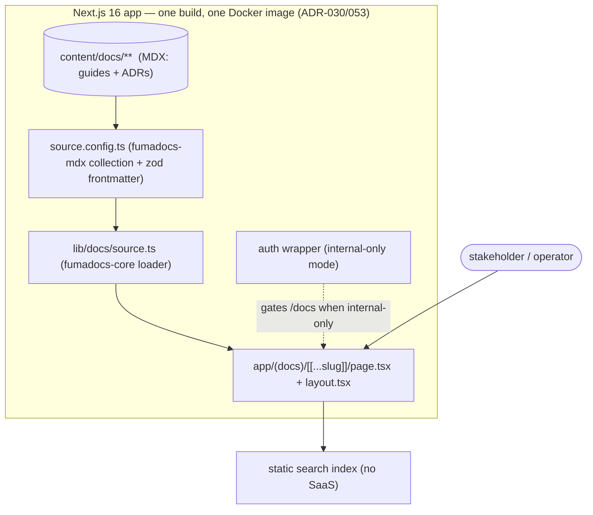

# Blueprint — Docs site (Fumadocs, mounted in the Next app)

Scope: app/[locale]/docs/**, app/api/docs-search/**, app/fumadocs-tokens.css, content/docs/**, lib/docs/**, source.config.ts, scripts/enable-docs-site.mjs, scripts/templates/docs-site/**

> The `blueprint-gate.mjs` hook (ADR-033) matches NEW `app/api/**/route.ts` + `app/**/page.tsx`
> against this `Scope:` line. The `app/[locale]/docs/**` glob pre-authorizes the docs pages under
> the locale segment (the operator-resolved mount path, `/{locale}/docs`); `app/api/docs-search/**`
> covers the Fumadocs search route; `content/docs/**`, `lib/docs/**`, and `source.config.ts` cover
> the MDX content tree, the source adapter, and the Fumadocs source config; the enabler script
> emits all of them into an opting-in fork. This is the code-wave contract for ADR-053 (Accepted) —
> a `/scale-up` opt-in, not a base-template default.

## Problem & outcome

The repo carries a large prose corpus — `README.md`, `SECURITY.md`, the `docs/*.md` guides, and
the `docs/decisions/ADR-*.md` series — but has **no rendered docs site**: no full-text search, no
navigation tree, no cross-reference UI, no shareable browsable URL for a non-developer stakeholder.
Today that content is read in-editor or on GitHub only. The v2 enterprise-benchmark sweep
(`docs/research/v2/20-remaining-sweep.md`, surface #1) flagged this as a **P1 net-new** gap.

**Outcome:** when this ships (as an opt-in `/scale-up` recipe), a fork mounts a **Fumadocs** docs
site as a route group **inside the existing Next.js 16 app** — one `next build`, one Docker image,
no second toolchain (ADR-053). A stakeholder opens a deployed `*.vercel.app`/tenant URL and browses
the guides + ADRs with search and a nav tree; an operator adds a docs page by committing a markdown/
MDX file under `content/docs/`. Internal-only docs sit behind the existing auth wrappers. Forks that
don't opt in are byte-for-byte untouched.

## Market scan

Source: `docs/research/v2/20-remaining-sweep.md` §1 (4-lens top-10 + head-to-head). Decision recorded
in ADR-053.

- **Fumadocs** (chosen) — MIT, Next.js App-Router / RSC-native; mounts as a route group **inside**
  the existing app (one build, one image). Only real gap: no out-of-box doc versioning — which a
  deploy-per-tenant repo barely needs.
- **Nextra** (Vercel) — MIT, Next/MDX, but shaped as a standalone docs app; weaker in-app fit.
- **Astro Starlight** — MIT, fast + batteries-included, but a separate Astro toolchain off the
  React/Next rail (second build system).
- **VitePress** — MIT, great DX, but Vue/Vite — off the ADR-001 rail.
- **Mintlify / GitBook (SaaS)** — polished OpenAPI/AI-search UX, but hosted proprietary SaaS —
  **fails the self-host pivot**.
- **Docusaurus** (Meta, MIT) — most battle-tested, native versioning + i18n, but its own webpack
  build is a second build system. **Kept as the documented fallback** for heavy versioned/i18n
  _public_ docs.
- **Plain markdown (status quo)** — zero-cost, but no search / nav / shareable URL (the gap).

Verdict: **ADD-AS-OPTION → Fumadocs (Fit 5/5)**, Docusaurus as the versioned-public-docs fallback.
Net-new deps `fumadocs-core` / `fumadocs-ui` / `fumadocs-mdx` (MIT, React — on-rail, no
Ask-before-dep concern; the closest existing primitive is none — this is a genuine net-new
capability, recorded in the build-vs-buy ledger).

## Tier

**shared** — enterprise-facing infrastructure that adds a route group and a build integration on the
locked stack (ADR-001), touches the container/deploy story (ADR-006/030/035), and can front
internal-only content behind auth. It is landed **additively** as a `/scale-up` opt-in, so the
_template's_ default `project.config.json` tier stays `personal`; the work itself is held to
shared-tier ceremony (full `/ship` + `/code-review` + `senior-code-reviewer` per increment, SECURITY.md
touch-check for the docs route's auth posture).

## User stories (stable IDs — the traceability spine)

- **US1** — As a **non-developer stakeholder**, I want to browse the deployed docs at a shared URL
  with search and a nav tree, so that I can read the guides + ADRs without an editor or GitHub.
  - **AC-1.1** — WHEN the app is deployed with the docs recipe enabled THE SYSTEM SHALL serve a docs
    site at a stable path (e.g. `/docs`) rendering the `content/docs/**` tree with a navigation
    sidebar and a table of contents.
  - **AC-1.2** — WHEN a stakeholder types a query into docs search THE SYSTEM SHALL return matching
    pages by title/heading/body via a static (client-side or RSC) index — no external search SaaS.
  - **AC-1.3** — WHEN the docs site renders THE SYSTEM SHALL be theme-aware (light/dark) and RTL-safe
    for `ar` when the fork enables that locale, consistent with the app chrome.
- **US2** — As an **operator (non-developer)**, I want to add a docs page by committing a markdown/
  MDX file, so that publishing is a `git push`, not a CMS.
  - **AC-2.1** — WHEN an operator adds `content/docs/<slug>.mdx` with valid frontmatter (title) and
    pushes THE SYSTEM SHALL surface the new page in the nav and at `/docs/<slug>` after the build,
    with no code change.
  - **AC-2.2** — WHEN an MDX file has malformed frontmatter or a broken internal link THE SYSTEM
    SHALL fail the build (or the docs typecheck) with a file-pointed error — not ship a blank/500 page.
- **US3** — As a **security owner**, I want internal-only docs gated, so that Restricted/internal
  content is not exposed by adding a docs site.
  - **AC-3.1** — WHEN the recipe is configured internal-only THE SYSTEM SHALL front the `app/(docs)`
    route group with the existing auth wrapper so an unauthenticated request is redirected/denied
    like any other protected page.
  - **AC-3.2** — WHEN docs are public-facing (operator opt-in) THE SYSTEM SHALL serve them without
    auth AND the recipe SHALL warn that only non-Restricted content belongs in `content/docs/**`.

## Scenarios (Given/When/Then — worst path mandatory)

- **US1-happy** — Given a deployed app with the docs recipe on, When a stakeholder opens `/docs` and
  searches "audit", Then the ADR/guide pages mentioning audit appear and open with nav + TOC
  (AC-1.1/1.2).
- **US1-worst** — Given the `ar` locale enabled with dark theme, When the stakeholder opens `/docs`,
  Then the layout renders RTL and dark-correct with no clipped nav or mojibake (AC-1.3) — not a
  broken LTR frame.
- **US2-happy** — Given an operator commits `content/docs/onboarding.mdx` with `title:`, When the
  build runs, Then `/docs/onboarding` renders and appears in the sidebar with no code edit (AC-2.1).
- **US2-worst** — Given an operator commits an MDX file with no `title` frontmatter and a link to a
  non-existent page, When `/ship`/build runs, Then it fails with the offending file path (AC-2.2) —
  never silently ships a blank page or a dangling link.
- **US3-happy** — Given internal-only config, When an unauthenticated visitor requests `/docs`, Then
  they hit the same auth redirect as any protected page (AC-3.1).
- **US3-worst** — Given internal-only config, When someone deep-links `/docs/security-internal`
  without a session, Then the auth wrapper denies it before rendering — no content leak (AC-3.1) —
  and the recipe's public-mode warning (AC-3.2) prevents Restricted content from being placed in a
  public tree by policy.

## Architecture sketch

- **Route group** — `app/(docs)/` holds the Fumadocs UI: a `layout.tsx` (DocsLayout + sidebar/nav
  tree) and a catch-all `[[...slug]]/page.tsx` that resolves a slug to an MDX page via the source
  adapter. It renders through the same `next build` and ships in the same Docker image (ADR-030/035);
  no second build system (ADR-053 driver). For internal-only forks the group is wrapped by the
  existing auth wrapper (`lib/api-helpers.ts` / the app's protected-page pattern).
- **Content** — `content/docs/**` is the MDX source tree (markdown + frontmatter `title`/`description`).
  Adding a page = adding a file. The existing `docs/*.md` + `docs/decisions/ADR-*.md` corpus is
  surfaced either by pointing the source root at it or by a thin sync — resolved in Open questions.
- **Source config** — `source.config.ts` (fumadocs-mdx) declares the collection(s) and frontmatter
  schema (zod-validated title/description), producing the typed page source consumed at build.
- **Source adapter** — `lib/docs/` wraps `loader()` from `fumadocs-core` over the generated source:
  `source.ts` (page tree + `getPage`/`getPages`), plus small helpers (nav, breadcrumbs). This is the
  seam the route group imports — keeps Fumadocs internals out of `app/`.
- **Search** — static/client-side search over the built index (Fumadocs' bundled search — Orama or
  the built-in static index), no external search SaaS (AC-1.2). RSC reads for page content (Speed
  pillar).
- **Theming** — reuse the app's token/theme surface so light/dark + RTL follow the chrome (AC-1.3);
  no raw hex (ESLint `no-raw-hex-color`).

## The five pillars

- **Speed** — RSC page reads; static/build-time search index (no per-query round-trip to a search
  SaaS); bounded page payloads; docs render in the same build with no extra runtime service.
- **Secure** — internal-only mode fronts `app/(docs)` with the existing auth wrapper (AC-3.1); the
  recipe warns that only non-Restricted content belongs in a public `content/docs/**` (AC-3.2); no
  new secret surface; frontmatter is zod-validated at the boundary (`source.config.ts`).
- **Maintainable** — thin wrapper over vetted MIT libs (`fumadocs-*`); Fumadocs internals confined to
  `lib/docs/`; content is plain MDX files; recorded in the build-vs-buy ledger; net-new deps are
  on-rail (React/Next), no Ask-before-dep concern.
- **Scalable** — the docs tree is bounded, statically built, and paginated by nav sections; adding
  pages is O(1) files with no N+1 — search is a prebuilt index, not a live query per keystroke.
- **High-Quality** — honest states: a malformed MDX file or broken link fails the build with a
  file-pointed error (AC-2.2), never a blank/500 page; theme-aware + RTL-safe (AC-1.3); axe-clean nav/
  search; on-token colors (`no-raw-hex-color`).

## Open questions — RESOLVED (operator, AskUserQuestion 2026-07-12)

- [x] **Content source** → **dedicated `content/docs/**` tree** with the ADR series pulled in (per the
      `Scope:` line). Curated site IA decoupled from the repo `docs/` layout; a light sync/curation
      step is accepted. _(operator: "Dedicated content/docs/\**")_
- [x] **Default access posture** → **internal-only (auth-gated) by default**, public as a fork opt-in.
      `app/(docs)` fronts the existing auth wrapper; the recipe warns only non-Restricted content
      belongs in a public tree. _(operator: "Internal-only (auth-gated)")_
- [x] **Path + i18n** → **under `[locale]` at `/{locale}/docs`** so docs get `en`/`ar` + RTL for free
      and share the app chrome. NOTE: this differs from the opt-in `/api-reference` (which is
      non-localized); the docs site is inside `[locale]`, so the middleware needs no `/api-reference`-
      style special case. _(operator: "Under [locale] at /{locale}/docs")_
- [x] **Versioning need** → **unversioned for v1** (no Docusaurus-fallback trigger). _(operator:
      confirmed default by non-objection)_
- [x] **ADR ingestion** → **light frontmatter shim** in the source adapter; ADR bodies unchanged.
      _(operator: confirmed default by non-objection)_

## Docker path (senior-review follow-through, 2026-07-13)

The enabler was originally verified on the Vercel/`next build` path only; the senior
breadth review reproduced two Docker-rail defects, both fixed in the enabler:

- **postinstall is GUARDED.** The Dockerfile `deps` stage runs `npm ci` with only
  `package.json`+lock present; a bare `fumadocs-mdx` postinstall exits 1 there and
  fails every image build of an enabled fork. The enabler therefore writes a
  `node -e` guard that no-ops when `source.config.ts` is absent and fails loudly
  when it exists but generation fails. The `builder` stage needs no extra step:
  `next build`'s `createMDX` plugin regenerates `.source/` itself.
- **`.dockerignore` exception (5th config patch).** The template excludes `*.md`
  from the build context, which silently emptied the ADR collection
  (`docs/decisions/**/*.md`) in images; the enabler now appends
  `!docs/decisions/*.md` (optional patch — skipped if a fork dropped the file).

**Accepted trade-off / scheduled follow-up:** the 9 emitted `.tpl` files are outside
the pristine template's typecheck (by design — the deps aren't installed), so a
`lib/api-helpers`/`lib/auth`/`brand.config`/`i18n/config` API refactor won't redden
`/ship` until a fork enables. Detection points today: this blueprint's verified
round-trip + the enable-time build. Follow-up when wanted: a `/ship --full`-tier
phase that enables into a disposable checkout and runs `tsc --noEmit` + `next build`.
