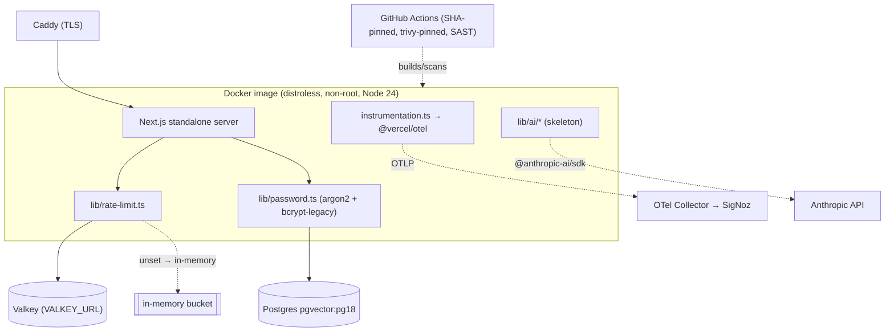

# Blueprint — Enterprise P0 baseline (the v1 enterprise pivot floor)

Scope: Dockerfile, .dockerignore, compose.prod.yaml, Caddyfile, docker/**, instrumentation.ts,
lib/ai/**, lib/authz/**, lib/observability/**, lib/otel/**, lib/rate-limit/**, lib/valkey.ts,
lib/password.ts, lib/auth.ts, app/api/users/**/route.ts, app/api/auth/**/route.ts,
.github/workflows/**, .semgrep/**, semgrep.yml, .config/semgrep/**

> The `blueprint-gate.mjs` hook (ADR-033) matches NEW `app/api/**/route.ts` + `app/**/page.tsx`
> against the `Scope:` line. The P0 baseline adds NO new routes/pages (the AI layer is
> skeleton-only this phase — operator decision), so the gate does not fire here; the globs above
> pre-authorize the increments this blueprint governs (incl. the argon2 edits to existing routes).

## Problem & outcome
The template was built as a **prototype rail** (ADR-006/007: Vercel + Neon, solo operator, CI
dormant, in-memory everything). The enterprise pivot (source of truth:
`docs/research/v2/enterprise-benchmark-v2.html` P0 action plan + `PHASE-2-BACKLOG.md`) requires an
**enterprise floor**: a self-hostable, per-tenant, security-hardened baseline. This blueprint is
the contract for the P0 slice — the load-bearing gaps and one active security cliff — landed
**additively** (operator decision: keep the Vercel/personal defaults; add the enterprise rail
alongside as opt-in). When this ships, an operator can build a container image that boots a
tenant with a shared-state rate limiter, Argon2id password hashing, a pinned/hardened supply
chain, an observability seam, and a Claude-native AI runtime skeleton — without any of it
breaking the existing reviewer-URL loop.

## Market scan
- **Delivery**: distroless + multi-stage (Google `distroless/nodejs` vs `node:slim`) — distroless
  chosen for a smaller attack surface (no shell/pkg-mgr). Caddy vs Traefik vs nginx for TLS —
  Caddy for automatic HTTPS with the least config. Verdict recorded in ADR-035.
- **Rate limiter**: `@upstash/ratelimit` (SaaS-leaning) vs `rate-limiter-flexible` on **Valkey**
  (Redis fork, BSD; Redis itself relicensed off OSS 2024). `rate-limiter-flexible` chosen — it
  supports an in-memory + Valkey backend behind one API (ADR-035, ledger 2026-07-11).
- **Password hashing**: `bcryptjs` (current) vs `@node-rs/argon2` (Argon2id, OWASP default,
  prebuilt napi) vs `argon2` (node-gyp). `@node-rs/argon2` chosen; `hash-wasm` fallback (ADR-039).
- **Observability**: Sentry-only SaaS vs **OpenTelemetry** + swappable backend (SigNoz/GlitchTip).
  OTel chosen for instrument-once/swap-backend + license-clean redistribution (ADR-040).
- **AI runtime**: Mastra/LangGraph frameworks vs a thin wrapper on Anthropic's native Tool Runner.
  Build-thin chosen (ADR-036, ledger 2026-07-11).

## Tier
**shared** — this is enterprise-facing infrastructure touching the Ask-before surface (`lib/`,
`lib/auth.ts`, workflows, `middleware`-adjacent). It is landed additively, so the *template's*
default `project.config.json` tier stays `personal` (operator decision: Additive) — but the work
itself is held to shared-tier ceremony (SECURITY.md updates, findings-register discipline, full
`/ship` + `/code-review` + `senior-code-reviewer` per increment).

## User stories  (stable IDs — the traceability spine)
- **US1** — As a **platform operator**, I want a distroless, non-root, digest-pinned container
  image + a `compose.prod.yaml`, so that I can self-host a tenant outside Vercel.
  - **AC-1.1** — WHEN `make docker-build` runs on a green tree THE SYSTEM SHALL produce a bootable
    non-root image whose base is pinned to a digest (Node 24).
  - **AC-1.2** — WHEN `docker compose -f compose.prod.yaml up` runs with the default profile THE
    SYSTEM SHALL start app + Caddy (TLS) + a bundled `pgvector/pgvector:pg18` Postgres and run
    pending migrations at startup over a direct URL before serving traffic.
  - **AC-1.3** — IF the operator selects the `external-db` profile THEN THE SYSTEM SHALL start
    app + Caddy only and consume `DATABASE_URL` for a managed Postgres (no bundled DB container).
- **US2** — As a **tenant end-user behind a load balancer**, I want rate limits enforced across
  replicas, so that the documented limit is the real limit.
  - **AC-2.1** — WHEN >1 app replica runs with `VALKEY_URL` set THE SYSTEM SHALL enforce one
    shared quota via Valkey (not N×configured).
  - **AC-2.2** — IF `VALKEY_URL` is unset THEN THE SYSTEM SHALL fall back to the in-memory limiter
    (single-container correctness preserved) and the public `rateLimit()` API SHALL be unchanged.
- **US3** — As a **security owner**, I want Argon2id password hashing with silent legacy
  migration, so that no user is disrupted and no bcrypt hash is trusted forever.
  - **AC-3.1** — WHEN a new password is hashed THE SYSTEM SHALL emit an Argon2id hash
    (`$argon2id$…`) at OWASP-baseline params.
  - **AC-3.2** — WHEN a user with a legacy `$2…` bcrypt hash logs in with the correct password THE
    SYSTEM SHALL verify via bcrypt AND rehash to Argon2id transparently.
  - **AC-3.3** — IF a wrong password is supplied THEN THE SYSTEM SHALL reject with the existing
    "invalid credentials" path (no 500, no hash-format leak).
- **US4** — As a **release engineer**, I want the supply chain pinned and hardened, so that a
  compromised scanner/action cannot run in CI.
  - **AC-4.1** — WHEN any workflow references a GitHub Action THE SYSTEM SHALL pin it to a full
    40-char commit SHA (not a mutable tag).
  - **AC-4.2** — WHEN Trivy runs THE SYSTEM SHALL use a pinned version ≤0.69.3 / trivy-action
    v0.35.0 / setup-trivy v0.2.6 (never `latest`).
  - **AC-4.3** — WHEN CI runs on a push THE SYSTEM SHALL run a Semgrep/Opengrep SAST gate that
    blocks on its ruleset.
- **US5** — As an **SRE**, I want an OpenTelemetry seam, so that traces/metrics/logs export to a
  swappable backend without app-code changes.
  - **AC-5.1** — WHEN `OTEL_EXPORTER_OTLP_ENDPOINT` is set THE SYSTEM SHALL export OTLP from
    `instrumentation.ts`; WHEN unset THE SYSTEM SHALL be a silent no-op (zero overhead).
- **US6** — As a **developer**, I want a Claude-native AI runtime skeleton, so that AI features
  build on a thin, typed, tested wrapper rather than a framework.
  - **AC-6.1** — WHEN `lib/ai` is imported THE SYSTEM SHALL expose a typed provider + a thin
    native Tool-Runner wrapper backed by `@anthropic-ai/sdk`, with unit tests, and NO live route
    (skeleton-only — operator decision).

## Scenarios (per story; Given/When/Then — worst path mandatory)
- **US1-happy** — Given a green tree, When `make docker-build && docker compose -f
  compose.prod.yaml up`, Then app boots non-root, migrations apply, Caddy serves TLS (AC-1.1/1.2).
- **US1-worst** — Given a migration that would drop a column the running version reads, When
  startup migration runs, Then it is rejected by the forward-compatible-only rule (documented;
  migrations are additive) — not a half-migrated DB (AC-1.2).
- **US2-happy** — Given 3 replicas + `VALKEY_URL`, When a client exceeds the limit, Then the 4th
  request 429s with `Retry-After` regardless of which replica serves it (AC-2.1).
- **US2-worst** — Given `VALKEY_URL` set but Valkey unreachable, When a request arrives, Then the
  limiter fails **closed-safe** (denies or falls back per a documented policy) and logs — never
  crashes the route (AC-2.2 + new resilience note).
- **US3-happy** — Given a seeded bcrypt admin, When they log in correctly, Then login succeeds and
  the stored hash becomes `$argon2id$…` (AC-3.2).
- **US3-worst** — Given the same admin, When a wrong password is tried, Then reject via the
  existing path; the stored hash is unchanged (AC-3.3).
- **US4-worst** — Given a workflow edited to reference `trivy@latest` or a tag-pinned action, When
  CI/zizmor runs, Then it fails the pin check (AC-4.1/4.2).
- **US5-worst** — Given no OTLP endpoint configured, When the app runs, Then no exporter errors
  and no measurable overhead (AC-5.1).
- **US6-worst** — Given the AI skeleton, When imported in tests with no API key, Then it
  constructs without throwing and the tool-runner loop is unit-tested against a mocked client
  (AC-6.1).

## Delta — was → now
| Surface | Was | Now | Who notices the break? |
|---|---|---|---|
| `lib/password.ts` `hashPassword` | bcrypt hash (cost 12) | Argon2id hash; new `verifyPassword`/`needsRehash` | callers of `hashPassword` (unchanged sig) + `password.test.ts` (asserts `$2…` → must assert `$argon2id$`) |
| `lib/auth.ts:81` credentials verify | `bcrypt.compare` | `verifyPassword` (bcrypt-legacy + argon2) + rehash-on-login | `auth.test.ts` (mocks `bcryptjs` → must mock verify path) |
| `app/api/users/[id]/password/route.ts` | `bcrypt.compare` for currentPassword | `verifyPassword` | that route's test path |
| `lib/rate-limit.ts` | in-memory only | Valkey-backed when `VALKEY_URL` set, in-memory fallback | horizontally-scaled deployments (fixes SECURITY.md T-01) |
| `.github/workflows/*` | tag-pinned actions, trivy `latest`, `sast.yml` dormant | SHA-pinned, trivy pinned, SAST as a hard gate | CI once Actions activate |
| `instrumentation.ts` | (absent) | OTel bootstrap, no-op when unconfigured | n/a — additive |
| `next.config.ts` / base image | Node 22 | Node 24 (Docker base + `@types/node`) | native deps rebuild in-image |

## Domain model
No **new** entities in P0 (infra/security baseline). The only data touched is the existing
**User** model's Restricted `passwordHash` field (hash-format change, same column).

| Entity | Key attributes | Restricted? (§1) | Enums | Relationships |
|---|---|---|---|---|
| `User` (existing) | `passwordHash:string` (algorithm changes bcrypt→argon2, same column), `passwordChangedAt:date` | **yes** (`passwordHash`) | `role: USER\|ADMIN` (unchanged) | existing |

- **Invariants**: `passwordHash` stays in `SCRUB_FIELDS` (`lib/prisma/audit-extension.ts`) — no
  change needed (already scrubbed). No new migration (no schema change; the hash string format
  changes, the column type does not). `pgvector`/`pg-boss` tables are **P1**, not this phase.
- **Reuse check**: reuses `User` + `lib/password.ts` + `lib/auth.ts`; no new noun.
- **ADR-031**: this is a genuinely no-new-entity infra change; it reads/writes the existing `User`
  model, so the grid is non-empty per the "name the existing model" rule — no `dbAck` needed.

## Architecture sketch
- **Delivery**: `Dockerfile` (multi-stage: deps → build → distroless runtime, non-root UID,
  `output: "standalone"` under `DOCKER_BUILD=1` per ADR-023/030) → `compose.prod.yaml` (profiles:
  `bundled-db` default = app+Caddy+pgvector-pg18+volume; `external-db` = app+Caddy) → `Caddyfile`
  (TLS termination + reverse proxy to app) → entrypoint runs `prisma migrate deploy` over a direct
  URL before `node server.js`.
- **Rate limit**: `lib/rate-limit.ts` keeps its public API (`rateLimit(req, opts)`); internally
  delegates to a Valkey-backed `rate-limiter-flexible` instance when `VALKEY_URL` is set (thin
  `lib/valkey.ts` client), else the existing in-memory bucket. No route signatures change.
- **Password**: `lib/password.ts` gains `verifyPassword(plain, hash)` (detects `$2` prefix →
  bcrypt, else argon2) + `needsRehash(hash)`; `lib/auth.ts` + the password route call
  `verifyPassword` and rehash on successful legacy verify. `bcryptjs` stays as a dep (legacy
  verify only).
- **Supply chain**: workflows SHA-pinned; `trivy`/`trivy-action`/`setup-trivy` version-pinned;
  `sast.yml` (Semgrep/Opengrep) promoted to a hard gate; `zizmor` audits pins.
- **Observability**: root `instrumentation.ts` registers `@vercel/otel`; thin `lib/observability/`
  helpers; OTLP endpoint from env; Collector→SigNoz is a deploy-time backend choice, not code.
- **AI**: `lib/ai/` — `provider.ts` (Anthropic client factory + config), `tool-runner.ts` (thin
  wrapper on the native Tool Runner agentic loop), `types.ts`; unit-tested against a mocked SDK.
  No route this phase.

## The five pillars
- **Speed** — OTel no-op when unconfigured; Valkey client pooled; argon2 params tuned not maxed;
  fast `/ship` loop stays image-free (ADR-030).
- **Maintainable** — thin wrappers over vetted libs (rate-limiter-flexible, @node-rs/argon2,
  @vercel/otel, @anthropic-ai/sdk); no framework lock-in; each capability has an ADR + ledger entry.
- **Scalable** — the headline fix: shared-state rate limiting removes the N×replica correctness
  bug; migration-at-startup handles multi-replica via an init-container job (documented).
- **Secure** — Argon2id (OWASP), pinned/SHA-pinned supply chain (closes the active Trivy hole),
  SAST gate, distroless non-root image, `VALKEY_URL`/secrets never logged.
- **High-Quality** — honest fallbacks (rate-limit fails safe; OTel silent no-op; AI skeleton
  constructs without a key); every increment lands `/ship` green + `/code-review` +
  `senior-code-reviewer`; SECURITY.md updated for the argon2 window.

## Open questions  (resolved via AskUserQuestion 2026-07-11)
- [x] How far to flip template defaults this phase? → **Additive** — keep personal/Vercel default,
  add the enterprise rail alongside as opt-in.
- [x] Default Docker DB topology? → **Both profiles, bundled Postgres (pgvector:pg18) as the
  default**, external-DB-URL profile available.
- [x] lib/ai scope for P0? → **Skeleton only** — provider + tool-runner wrapper + tests, no live
  route; `/scaffold-ai-endpoint` + ai-eval gate + AI-Quality pillar deferred to a WS-5 increment.
- [x] Rate-limiter behavior when `VALKEY_URL` set but Valkey unreachable? → **fail-safe with
  documented policy + log** (worst-path AC-2.2); resolved as a design rule, not an operator ask.
