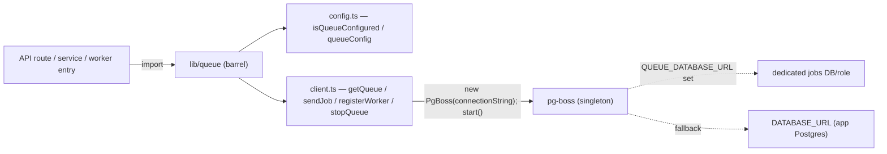

# Blueprint — Enterprise: pg-boss background-job seam

Scope: lib/queue/**

> Governs the background-jobs seam (code-wave item 5, operator-approved 2026-07-13; the
> Ask-before-sized `pg-boss` runtime dep (over 50 KB) is pre-authorized by that decision).
> It adds NO new `app/api/**/route.ts` or `app/**/page.tsx` (seam-only), so the
> `blueprint-gate.mjs` hook (ADR-033) does not fire; this file is the requirements contract
> `/qa`/`/uat` trace against. Build-vs-buy is recorded in `docs/build-vs-buy-ledger.md`
> (2026-07-11 — Background job queue, pg-boss; `Scope: lib/queue/**`). Pattern of record:
> the "silent no-op until configured" seam of `lib/ai/*` (ADR-036) and
> `lib/observability/*` (ADR-040).

## Problem & outcome

The template ships no durable background-job rail: anything slower than a request (bulk
email, exports, retries, scheduled fan-out) either blocks the route or gets lost on a cold
start. The `/scale-up` recipe table names the trade-off — Inngest is the SaaS path; **pg-boss
is the self-host path that rides the mandatory Postgres** (no Redis, no new datastore, no
external scheduler), which is why the ledger adopted it. This increment lands the **seam
only**: a config gate, a lazily-started singleton client, and thin `sendJob`/`registerWorker`/
`stopQueue` helpers — the smallest surface a later increment (a worker entrypoint on the
Docker rail, real job definitions, a dead-letter dashboard) builds on.

When this ships, a developer can `import { isQueueConfigured, sendJob } from "@/lib/queue"`
and get a typed, tested, durable enqueue — with the whole layer a **silent no-op when
unconfigured**, exactly like AI (`AI_API_KEY`), OTel (`OTEL_EXPORTER_OTLP_ENDPOINT`), and
email (`SMTP_HOST`).

## Decisions of record

- **Explicit `QUEUE_ENABLED="true"` opt-in (not URL-presence gating).** Every other seam
  gates on its own distinguishing var; the queue's natural var is a Postgres URL — which is
  ALWAYS present in this stack. Gating on the URL alone would silently start pg-boss
  constructing tables in and polling the app database on every deploy. So the gate is
  `QUEUE_ENABLED === "true"` AND a URL; `lib/env.ts` validates the flag as a loud boot-time
  enum (`"true" | "false"`) so a typo'd `"1"`/`"yes"` fails startup instead of silently
  staying off.
- **pg-boss over Inngest/BullMQ/Temporal** (ledger 2026-07-11): Inngest is SaaS (kept as the
  `/scale-up` hosted recipe), BullMQ needs Redis/Valkey plus workers, Temporal is heavy;
  pg-boss reuses the existing Postgres — the same "no new datastore" reasoning that put RAG
  on pgvector.
- **`QUEUE_DATABASE_URL` override, `DATABASE_URL` fallback.** Default rides the app DB
  (zero setup); a dedicated DB/role is a deploy-time env change (least privilege, isolates
  job-table churn/vacuum from app tables). Classified Confidential alongside `DATABASE_URL`
  (SECURITY.md §1).
- **Singleton, lazily started, no top-level side effects.** Unlike the per-call AI client,
  pg-boss owns a pool + maintenance loops, so `getQueue()` starts one instance per process
  on first use and `stopQueue()` tears it down; importing the barrel constructs nothing.

## Users & stories (EARS; worst path mandatory)

- **US1** — As a **developer**, I want a durable enqueue helper, so background work survives
  restarts without new infrastructure.
  - **AC-1.1** — WHEN the layer is configured and `sendJob(name, data, opts?)` is called THE
    SYSTEM SHALL create the queue on first use and enqueue via pg-boss `send`, returning the
    job id.
  - **AC-1.2 (worst)** — WHEN any queue operation (`getQueue`/`sendJob`/`registerWorker`)
    runs unconfigured THE SYSTEM SHALL throw `QueueNotConfiguredError` naming the vars to
    set, BEFORE constructing a client or opening a connection.
- **US2** — As a **developer**, I want a worker registration helper, so job processing uses
  the same seam.
  - **AC-2.1** — WHEN `registerWorker(name, handler, opts?)` is called on a configured layer
    THE SYSTEM SHALL register the batch handler via pg-boss `work` and return the worker id.
  - **AC-2.2 (worst)** — WHEN pg-boss emits an internal `error` event THE SYSTEM SHALL log
    metadata only (never the connection string) and SHALL NOT crash the process.
- **US3** — As an **operator**, I want the queue OFF by default, so a deploy never starts
  polling my database without consent.
  - **AC-3.1** — WHEN `QUEUE_ENABLED` is unset (or any value other than `"true"`) THE SYSTEM
    SHALL report `isQueueConfigured()` false even though `DATABASE_URL` is set.
  - **AC-3.2 (worst)** — WHEN `QUEUE_ENABLED` is a typo (`"1"`, `"yes"`) THE SYSTEM SHALL
    fail loud at boot (`lib/env.ts` enum), not silently disable.
- **US4** — As an **operator**, I want graceful teardown, so shutdown doesn't strand active
  jobs mid-flight.
  - **AC-4.1** — WHEN `stopQueue()` is called THE SYSTEM SHALL stop gracefully (pg-boss
    default wait) and reset the singleton; WHEN the queue never started it SHALL resolve as
    a no-op.

## Scenarios (Given/When/Then)

- **US1-happy** — Given `QUEUE_ENABLED="true"` + `DATABASE_URL`, When `sendJob("email-welcome",
{...})`, Then the queue is created on first use and a job id returns.
- **US1-worst** — Given `QUEUE_ENABLED` unset, When `sendJob(...)`, Then it rejects with
  `QueueNotConfiguredError`; nothing is constructed; `isQueueConfigured()` is false.
- **US3-happy** — Given only `QUEUE_DATABASE_URL` set (+ flag), Then `queueConfig()` resolves
  that URL; given both, the dedicated URL wins; given neither, it throws.
- **US4-happy** — Given a never-started process, When `stopQueue()`, Then it resolves without
  error (safe in shutdown hooks and tests).

## Architecture sketch

- `lib/queue/config.ts` — `isQueueConfigured()` / `queueConfig()` /
  `QueueNotConfiguredError`. Reads `process.env` at CALL time (the AI/OTel gate pattern);
  `lib/env.ts` owns the loud boot validation, this module owns the fallback default.
- `lib/queue/client.ts` — `getQueue()` lazily constructs + `start()`s the singleton (with an
  `error`-event listener so internal pg-boss errors can't crash Node); `sendJob` /
  `registerWorker` thin wrappers (both ensure the queue exists once per name — pg-boss v10+
  requires `createQueue` before `send`); `stopQueue()` graceful teardown.
- `lib/queue/index.ts` — barrel (`import from "@/lib/queue"`).
- `lib/env.ts` + `.env.example` — the `QUEUE_ENABLED` / `QUEUE_DATABASE_URL` contract.
- `tests/contracts/queue.test.ts` — node:test contract suite; never opens a DB connection
  (unconfigured paths throw pre-construction; configured paths test `queueConfig()` only).

## The five pillars

- **Speed** — zero cost when unconfigured (nothing constructed at import or call); one
  singleton pool when on; queue-existence checks cached per name per process.
- **Secure** — `QUEUE_DATABASE_URL` is Confidential (SECURITY.md §1), never logged (the
  error listener logs `error.message` metadata only); explicit opt-in means no ambient
  DB polling.
- **Maintainable** — thin wrapper over a vetted library (ledger 2026-07-11); no hand-rolled
  scheduler; mirrors the established seam pattern so the next reader already knows it.
- **Scalable** — durable jobs move slow work off request paths; a dedicated jobs DB is a
  deploy-time env change; pg-boss handles retries/backoff/dead-letter natively when a
  follow-on configures them.
- **High-Quality** — honest typed failure when off (no half-initialized client); contract
  tests cover the gate, URL resolution, all unconfigured worst paths, and teardown.

## Tier

`shared` (enterprise pivot). Seam-only; no route/page surface this phase.

## Explicitly deferred (follow-on increments)

- A worker entrypoint on the Docker self-host rail (serverless route handlers must not host
  `registerWorker` loops) + compose profile.
- Real job definitions (email fan-out, export generation) + per-queue retry/dead-letter
  config and a recycling-style dead-letter view.
- `/scale-up` recipe-table update pointing "background jobs (self-host)" at this seam.
- Scheduled (cron-style) jobs via pg-boss `schedule` vs. the existing Vercel Cron rail
  (ADR-018) — adjudicate when the first real scheduled job lands.

## Open questions (resolved 2026-07-13)

- [x] Gate on URL presence like other seams? → **No — explicit `QUEUE_ENABLED="true"`**;
      a DB URL is always present, so URL-gating would silently enable polling (operator-
      approved design decision, code-wave item 5).
- [x] pg-boss vs. Inngest? → **pg-boss** for the self-host rail (ledger 2026-07-11);
      Inngest stays the `/scale-up` SaaS recipe.
- [x] Dedicated jobs DB? → **Optional via `QUEUE_DATABASE_URL`**, app DB fallback.
