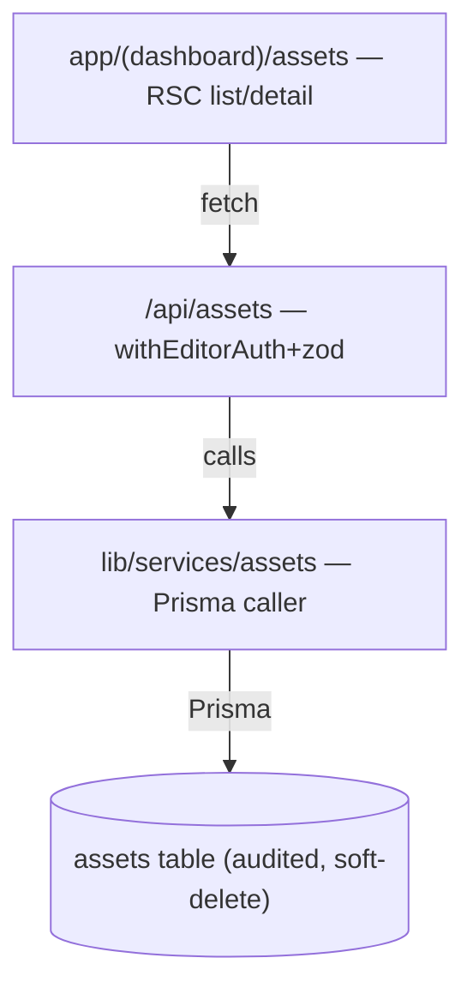

# Blueprint — HARNESS-V2 Phase 2: "Complete the loop"

Scope: .claude/skills/benchmark/**, .claude/skills/explore/**, .claude/skills/retro/**, docs/benchmarks/**, app/api/assets/**, app/\*\*/assets/\*\*, lib/services/assets/\*\*, tests/features/\*\*

Track: **Full** · Program: harness-v2 · Phase: 2 of 5 · Branch `claude/harness-v2-kickoff-yhid26`

## Problem & outcome

Phases 0–1 made the gates trustworthy and every session cheap. Phase 2 makes the
**development loop complete**: the harness can research a domain, diverge on
architecture, decompose into a parallel work-graph, implement, review against the
spec (not just the code), machine-verify story→test coverage, and retro — as one
continuous, evidenced loop. The proof is a **pilot feature** run end-to-end through
every station. When Phase 2 ships, "build a feature the right way" is a single
traceable pipeline, not a set of disconnected habits.

## Market scan

The stations mirror mature practice: BMAD/spec-kit (work-graph + `[P]`), OpenSpec
(delta proposals), playwright-bdd (Gherkin→Playwright), Snipe-IT/GLPI (the pilot's
OSS benchmark). Each is _adopted as a concept, built native_ per ADR-022 — except
playwright-bdd, which is a real dependency (V2-207, ledger + ADR). Rationale for
build-vs-adopt lives per-item in `docs/build-vs-buy-ledger.md`.

Feature parity: n/a — this is the PROGRAM blueprint (it only names the pilot's
category, `docs/benchmarks/it-asset-management.md`). The pilot's own feature blueprint
(V2-210) carries the `## Feature parity` section that dispositions that matrix.

## Tier

`personal` (matches `project.config.json`). Phase 2 adds skills/templates/gates —
it does not change the security floor. `shared`-tier enforcement paths (blueprint
parity block, amendment-unconfirmed block) are built now but only _warn_ on
`personal`, per the tier contract.

## ASK resolutions (KICKOFF §2.9 — operator waved the interactive round; defaults recorded)

- [x] **Pilot feature (V2-210)** → **synthetic IT Asset Tracker** (category: IT asset
      management). Chosen over the RSP / aptitude real slices because those require
      operator-private product code this session can't reach; a synthetic self-contained
      entity exercises every loop station honestly and is fully reproducible. Category has
      strong OSS benchmarks (Snipe-IT, GLPI) to mine for V2-201. _Operator may substitute a
      real slice later; the loop machinery is feature-agnostic._
- [x] **playwright-bdd (V2-207)** → **adopt**. It is what the Phase-2 exit criterion
      ("story→test coverage machine-verified; unimplemented scenario = failing test")
      requires. ADR written **Proposed** (amends ADR-008/016) — flagged for operator
      sign-off; the gate wires into `/ship --full` (V2-401, Phase 4) so warm `/ship` and
      the current green bar are untouched until then.

## User stories (the machinery + the pilot; stable IDs)

- **US1** — As the operator, I want a `/benchmark <category>` skill, so that a new feature
  starts from a sourced parity matrix instead of guesses.
  - **AC-1.1** — WHEN `/benchmark it-asset-management` runs THE SYSTEM SHALL write
    `docs/benchmarks/it-asset-management.md` with table-stakes / differentiators /
    anti-features rows, each row citing a named product/OSS source.
- **US2** — As the operator, I want a `/explore` skill, so that architecture is chosen from
  2–3 evaluated options, not the first idea.
  - **AC-2.1** — WHEN `/explore` runs before a blueprint THE SYSTEM SHALL emit a
    pillars-aligned trade-off table AND auto-draft the losing options into a
    `docs/decisions/` ADR stub.
- **US3** — As the operator, I want a `/retro` skill, so that what broke/was-learned/was-missing
  is captured durably and missing features flow back to the benchmark.
  - **AC-3.1** — WHEN `/retro` runs THE SYSTEM SHALL append durable entries to
    `docs/agent-memory.md` sections AND append any "missing feature" to the relevant
    `docs/benchmarks/<category>.md`.
- **US4** — As a reviewer, I want two-stage review, so that out-of-scope/spec-violating
  changes are caught before code-quality nitpicks.
  - **AC-4.1** — WHEN a change adds a file outside every covering blueprint Scope THE
    SYSTEM SHALL surface it as a STAGE-1 spec-compliance finding.
- **US5** — As the operator, I want the blueprint to carry parity + app-floor + work-graph +
  amendment-delta sections, so that the contract is complete and drift is visible.
  - **AC-5.1** — WHEN a category benchmark exists but a blueprint omits the Feature Parity
    section THE SYSTEM SHALL warn (`personal`) / block (`shared`) in `/ship`.
  - **AC-5.2** — IF a signed blueprint is amended without re-confirming THEN `/ship` SHALL
    warn (`personal`) / block (`shared`).
- **US6** — As the operator, I want story→test coverage machine-verified, so that an
  unimplemented scenario fails instead of silently passing.
  - **AC-6.1** — WHEN `/ship --full` runs THE SYSTEM SHALL fail IF a story has no scenario
    or a scenario has no step definition.
- **US7 (pilot)** — As a fleet admin, I want to track IT assets, so that hardware is
  accounted for with an audit trail.
  - **AC-7.1** — WHEN an admin/editor creates an asset with valid data THE SYSTEM SHALL
    persist it (audited) and list it paginated.
  - **AC-7.2** — IF a non-editor attempts a write THEN THE SYSTEM SHALL 403.
  - **AC-7.3** — IF create input is invalid THEN THE SYSTEM SHALL reject with the zod
    message (not a 500).

## Scenarios (per story; worst path mandatory) — pilot US7

- **US7-happy** — Given an ADMIN session and valid asset data, When they POST /api/assets,
  Then a row is created, audited, and appears in the paginated list (AC-7.1).
- **US7-worst** — Given a VIEWER session, When they POST /api/assets, Then 403 and no write
  (AC-7.2); and Given invalid data (blank tag), When an editor submits, Then the zod
  message, not a 500 (AC-7.3).

(Machinery stories US1–US6 are exercised by running the loop itself; their scenarios are the
acceptance lines above, evidenced in `docs/HARNESS-V2-EVIDENCE.md`.)

## Delta — was → now

| Surface                                  | Was                            | Now                                                          | Who notices         |
| ---------------------------------------- | ------------------------------ | ------------------------------------------------------------ | ------------------- |
| `.claude/skills/blueprint`               | contract sections only         | + Feature Parity, App-floor, Work-graph DAG, Amendment delta | anyone blueprinting |
| `scripts/ship.mjs` (phase A)             | blueprint present/absent check | + parity-section warn, + amended-unconfirmed warn            | `/ship` users       |
| `.claude/agents/senior-code-reviewer.md` | quality review                 | + STAGE 1 spec-compliance before STAGE 2 quality             | reviewers           |
| `/ship --full` (future)                  | (no bdd gate)                  | + playwright-bdd story→scenario coverage gate (dormant)      | Phase 4 `--full`    |

## Domain model (pilot — Asset Tracker)

| Entity  | Key attributes                                                                                          | Restricted? | Enums                                                                                    | Relationships            |
| ------- | ------------------------------------------------------------------------------------------------------- | ----------- | ---------------------------------------------------------------------------------------- | ------------------------ |
| `Asset` | `assetTag:string!` (unique), `name:string`, `serial:string?`, `purchasedAt:date?`, `status`, `category` | no          | `status: IN_STOCK\|ASSIGNED\|REPAIR\|RETIRED`, `category: LAPTOP\|MONITOR\|PHONE\|OTHER` | `assignee → User? (N:1)` |

- **Invariants:** `assetTag` immutable after create + unique; legal status moves
  IN_STOCK→ASSIGNED→(REPAIR|RETIRED); writes = `editor` (ADMIN|EDITOR). Audited + soft-delete
  (scaffold wires both). Reuses the `User` model — no new person entity.

## Architecture sketch

- `GET/POST /api/assets` (`withEditorAuth` on write, `withAuth` on read, `withRateLimit`
  outside) → `lib/services/assets/*` (the only Prisma caller) → `assets` table.
- List route bounds results (`take`/`where`) — Scalable pillar. State in DB; reuses the
  shared `DataTable`, audit extension, soft-delete extension, recycling-bin registration.
- Migration: additive new table (forward-compatible). Built via `/scaffold-entity` where
  possible so audit/soft-delete/nav wiring is on-convention.

## The five pillars

- **Speed** — machinery is skills/templates (no runtime cost); pilot uses RSC + bounded lists.
- **Maintainable** — reuses DataTable/audit/soft-delete primitives; skills follow existing SKILL.md conventions.
- **Scalable** — pilot list paginates/bounds; no N+1.
- **Secure** — auth wrappers + zod on every pilot route; audited; no Restricted fields.
- **High-Quality** — honest empty/loading/error states; two-stage review + machine-verified coverage raise the floor.

## Work-graph DAG (V2-205 — dogfooded here; file-ownership sets + role-lens)

Legend: `[P]` parallel-eligible (write-disjoint) · `[S]` sequential (depends on a prior).

| #   | Item(s)                           | P/S                   | File-ownership set (globs)                                                                                                          | Role-lens (rule files / context) |
| --- | --------------------------------- | --------------------- | ----------------------------------------------------------------------------------------------------------------------------------- | -------------------------------- |
| A   | V2-201 /benchmark                 | [P]                   | `.claude/skills/benchmark/**`, `docs/benchmarks/it-asset-management.md`                                                             | harness (skill conventions)      |
| B   | V2-204 /explore                   | [P]                   | `.claude/skills/explore/**`                                                                                                         | harness                          |
| C   | V2-208 /retro                     | [P]                   | `.claude/skills/retro/**`                                                                                                           | harness                          |
| D   | V2-206 two-stage review           | [S after none]        | `.claude/agents/senior-code-reviewer.md`, `CLAUDE.md` (review-rail line)                                                            | harness + review                 |
| E   | V2-202/203/205/209 blueprint+ship | [S; touches ship.mjs] | `.claude/skills/blueprint/SKILL.md`, `scripts/ship.mjs`, `tests/harness/hooks.test.mjs`                                             | harness + api                    |
| F   | V2-207 playwright-bdd             | [S]                   | `docs/decisions/ADR-058-*.md`, `docs/build-vs-buy-ledger.md`, `scripts/bdd-coverage.mjs`, `playwright-bdd.config.*`, `package.json` | harness + testing                |
| G   | V2-210 pilot                      | [S after A–F]         | `app/api/assets/**`, `app/**/assets/**`, `lib/services/assets/**`, `prisma/**` (scaffold), `tests/features/**`                      | api + ui + auth                  |

**Wave 1 = {A, B, C}** — three write-disjoint new skill dirs → dispatch as a parallel
subagent wave via `/fan-out` (dogfoods V2-105; supplies V2-205's "≥1 wave executed in
parallel with ownership sets respected" evidence). D, E, F serialize (D and E both touch
shared review/ship surfaces; F depends on E's `--full` seam). G is last — it consumes A–F.

## Open questions (resolved)

- [x] Pilot choice → synthetic Asset Tracker (above).
- [x] playwright-bdd adoption → adopt, ADR Proposed pending sign-off (above).
- [x] `/ship --full` not yet built (Phase 4 V2-401) → the bdd gate ships **dormant** (a
      `scripts/bdd-coverage.mjs` invoked only under a `--full` flag / env), so warm `/ship`
      stays green; enforcement flips on when V2-401 lands.

_Confirmed: operator waved the interactive ASK ("continue"); defaults above stand and are
re-confirmable. Amendments to this blueprint append a delta block (V2-209) + reset this line._
