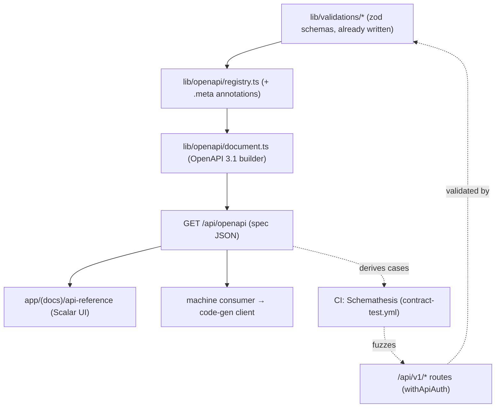

# Blueprint — OpenAPI contract seam for `/api/v1` (zod-openapi → Scalar → Schemathesis)

Scope: lib/openapi/**, app/api/openapi/route.ts, app/api/docs/route.ts, app/(docs)/api-reference/page.tsx, .github/workflows/contract-test.yml

> The `blueprint-gate.mjs` hook (ADR-033) matches NEW `app/api/**/route.ts` +
> `app/**/page.tsx` against the `Scope:` line. This blueprint pre-authorizes the code
> wave for the OpenAPI seam: the two new routes (`app/api/openapi/route.ts` serving the
> spec, `app/api/docs/route.ts` serving the Scalar UI shell) and the API-reference page
> (`app/(docs)/api-reference/page.tsx`), plus the `lib/openapi/**` generation layer and
> the CI contract-test workflow. Governance of record: ADR-052.

> **Update 2026-07-12 (item-2 closeout):** the Scalar UI (`@scalar/api-reference-react`,
> ~0.67MB client chunk) is now **opt-in** — removed from the default `package.json` and
> not shipped in `app/` so the template baseline stays under the 1.2MB size-limit budget
> (`sizeLimitAck` removed). Only the JSON contract seam (`lib/openapi/**` +
> `GET /api/openapi`) ships by default. A `/api/v1`-consumer fork runs
> `npm run enable:api-reference` to write the page (`app/(docs)/api-reference/page.tsx`,
> still Scope-covered above → gate-clean) + install the dep. See ADR-052's 2026-07-12
> update. `app/api/docs/route.ts` was never built (the page-only render satisfies US2).

## Problem & outcome

The template is REST + zod: every route validates its input at the boundary with a
schema under `lib/validations/`, and ADR-013 carved out a stable, versioned
**`/api/v1/*`** seam for machine consumers. But there is **no machine-readable
contract for that seam and no test that the running API still matches it**
(`docs/research/v2/20-remaining-sweep.md` §7a). A machine consumer integrating today
must read TypeScript route handlers by hand, discover error shapes empirically, and
trust that the deployed API still behaves as documented — with nothing catching
**contract drift** when a route's zod schema changes.

**Outcome:** because we already write zod at every boundary, generate an OpenAPI 3.1
spec _for free_ from those schemas, serve it at `GET /api/openapi`, render interactive
Scalar docs from it, and fuzz the deployed API against it in CI. When this ships, a
machine consumer code-generates a client from the spec, a developer reads live Scalar
docs that can't drift from the code, and CI fails when a route's response stops
matching its declared schema — all as a thin, additive, dormant-friendly layer that a
non-consumer fork pays nothing for.

## Market scan

From the remaining-surface sweep §7a (zod→OpenAPI + contract testing), all picks
MIT + self-hostable:

- **Spec generation:** `zod-openapi` (samchungy, v6, MIT, OpenAPI 3.1) — **chosen**,
  generates the spec from the zod schemas we _already write_, zero duplication, 3.1
  focus that matches zod/JSON-Schema semantics. Alternative:
  `@asteasolutions/zod-to-openapi` (MIT, ~2k) — mature, kept as the drop-in fallback
  (same architecture, heavier registry threading, weaker 3.1 story).
- **API-reference UI:** **Scalar** (MIT, ~11k) — modern, self-hostable, Mintlify-quality
  docs rendered from a spec; mounts inside the existing Next app (one build, one image).
  Alternative: Redocly CLI (lint + static docs).
- **Contract testing:** **Schemathesis** (MIT, ~2.5k, property-based) — fuzzes the API
  against its OpenAPI spec and finds contract drift automatically. Alternative: **Pact**
  (consumer-driven contracts) — heavier, for multi-service estates, deferred.
- **Rejected (recorded in ADR-052):** hand-written spec (duplicates every schema, drifts
  by default); tRPC (abandons the language-agnostic REST contract the `/api/v1` seam
  exists for, produces no OpenAPI document).

Redistribution/self-host posture holds: no SaaS docs (Mintlify/GitBook), no copyleft
snags — all three picks are MIT and ship in the tenant's own image.

## Tier

**shared** — this is enterprise-facing API infrastructure. It reads the `lib/validations/`
zod schemas and mounts on the `/api/v1` machine-consumer seam (ADR-013), which is
integration-contract surface. It is landed **additively** (the template's default
`project.config.json` tier stays `personal`; a fork that never exposes `/api/v1` gets a
dormant, cost-free layer), but the work itself is held to shared-tier ceremony: full
`/ship` green + `/code-review` + `senior-code-reviewer` per increment, SECURITY.md note
for any new externally-reachable route, findings-register discipline. It touches **no**
auth wrapper and **no** validation semantics — it _reads_ the existing zod, it does not
change it.

## User stories (stable IDs — the traceability spine)

- **US1** — As a **machine consumer of `/api/v1`**, I want a machine-readable OpenAPI 3.1
  spec, so that I can code-generate a typed client instead of reading route handlers.
  - **AC-1.1** — WHEN `GET /api/openapi` is requested THE SYSTEM SHALL return a valid
    OpenAPI **3.1** JSON document generated from the registered `lib/validations/` zod
    schemas (paths, request bodies, responses, error shapes).
  - **AC-1.2** — WHEN a route's zod schema changes THE SYSTEM SHALL reflect the change in
    the served spec on the next request with **no** hand-edit to any spec file (generated,
    not authored).
  - **AC-1.3** — WHEN a `/api/v1` route is registered in `lib/openapi/` THE SYSTEM SHALL
    include it in the document; an unregistered route is absent (coverage is explicit).
- **US2** — As a **developer**, I want interactive Scalar API docs in the app, so that I
  can explore the contract without external tooling.
  - **AC-2.1** — WHEN the API-reference page (`app/(docs)/api-reference/page.tsx`) loads
    THE SYSTEM SHALL render the Scalar UI populated from `GET /api/openapi`.
  - **AC-2.2** — WHEN the spec updates (a schema changed) THE SYSTEM SHALL show the change
    in the docs on reload without a rebuild of hand-written docs.
  - **AC-2.3** — IF the docs surface is configured internal-only THEN THE SYSTEM SHALL gate
    it behind the existing auth (no unauthenticated exposure of internal route shapes).
- **US3** — As a **release engineer**, I want CI to catch contract drift, so that a route
  that stops matching its own spec fails before a consumer sees it.
  - **AC-3.1** — WHEN the contract-test CI job runs against a preview/deployed URL THE
    SYSTEM SHALL fuzz `/api/v1` with Schemathesis derived from `GET /api/openapi` and fail
    on a schema-violating response or an undeclared 5xx.
  - **AC-3.2** — WHEN the job runs with no `/api/v1` routes / no seeded token THE SYSTEM
    SHALL be a dormant no-op (report-only, exit 0) — a non-consumer fork's CI is untouched.
  - **AC-3.3** — WHEN Schemathesis is promoted to a hard gate THE SYSTEM SHALL block the
    push on a detected drift (documented promotion path, mirrors the dormant→enforced gate
    posture).

## Scenarios (per story; Given/When/Then — worst path mandatory)

- **US1-happy** — Given routes with registered zod schemas, When `GET /api/openapi`, Then
  a valid OpenAPI 3.1 doc returns covering those routes (AC-1.1/1.3).
- **US1-worst** — Given a route whose zod schema was changed but whose OpenAPI metadata is
  stale, When the spec is generated, Then it reflects the _current_ zod (generation reads
  the live schema) — and an _unregistered_ route is simply absent, never silently wrong
  (AC-1.2/1.3). A schema that can't be represented in OpenAPI degrades to a terse-but-valid
  entry, never a 500 on `/api/openapi`.
- **US2-happy** — Given the spec route is up, When the reference page loads, Then Scalar
  renders the endpoints, request/response schemas, and examples (AC-2.1).
- **US2-worst** — Given the docs surface is marked internal-only, When an unauthenticated
  client requests it, Then it is denied by the existing auth — internal route shapes are
  not leaked to anonymous callers (AC-2.3).
- **US3-happy** — Given a preview URL + a seeded machine token, When the contract job runs,
  Then Schemathesis fuzzes `/api/v1` and passes on a conformant API (AC-3.1).
- **US3-worst** — Given a route edited to return a field its response schema forbids (or an
  undeclared 500 under fuzzed input), When the contract job runs, Then Schemathesis fails
  with the offending case — the drift is caught in CI, not by a consumer (AC-3.1). Given no
  `/api/v1` routes or no token, the job is a report-only no-op (AC-3.2).

## Delta — was → now

| Surface                               | Was                           | Now                                                                | Who notices the break?                        |
| ------------------------------------- | ----------------------------- | ------------------------------------------------------------------ | --------------------------------------------- |
| `lib/openapi/**`                      | (absent)                      | zod-openapi registry + document builder (reads `lib/validations/`) | new layer — additive                          |
| `app/api/openapi/route.ts`            | (absent)                      | serves the generated OpenAPI 3.1 JSON                              | machine consumers (new capability)            |
| `app/api/docs/route.ts`               | (absent)                      | serves the Scalar UI shell over the spec                           | developers viewing docs                       |
| `app/(docs)/api-reference/page.tsx`   | (absent)                      | interactive Scalar API reference page                              | developers viewing docs                       |
| `.github/workflows/contract-test.yml` | (absent)                      | Schemathesis contract-drift job (dormant→enforced)                 | CI once `/api/v1` + token exist               |
| `lib/validations/*`                   | zod schemas (validation only) | same schemas + optional OpenAPI `.meta()` annotations              | authors of new entities (one-line annotation) |
| `/scaffold-entity` (follow-up)        | emits zod + routes            | can additionally emit OpenAPI registration metadata                | future scaffolds (coverage grows by default)  |

## Domain model

**No new entities.** This is an API-contract/tooling seam. It _reads_ the existing
`lib/validations/` zod schemas and the `/api/v1` routes to produce a spec; it writes no
data, adds no Prisma model, and needs no migration.

| Entity                 | Key attributes                                   | Restricted? (§1) | Enums | Relationships |
| ---------------------- | ------------------------------------------------ | ---------------- | ----- | ------------- |
| (none — tooling layer) | reads existing zod schemas + route registrations | n/a              | n/a   | n/a           |

- **Invariants:** the spec must never expose secret/Restricted field _values_ — it
  describes schema _shapes_, not data; response examples must not embed real Restricted
  data. No `SCRUB_FIELDS` change (no new column). No migration (no schema change).
- **Reuse check:** reuses `lib/validations/*` (zod), the `/api/v1` seam (ADR-013), and the
  existing auth wrappers to gate the docs surface. New noun is only `lib/openapi/` (the
  generation layer) — recorded in the build-vs-buy ledger.
- **ADR-031:** no-new-entity infra change; reads existing schemas — no `dbAck` needed.

## Architecture sketch

- **Generation layer (`lib/openapi/`):** a `registry.ts` that collects each `/api/v1`
  route's zod request/response schemas (annotated via zod-openapi `.meta()`), and a
  `document.ts` that builds the OpenAPI 3.1 object (info, servers, security scheme =
  the `withApiAuth` Bearer seam, paths). Pure functions over the existing zod — no I/O,
  no data access.
- **Spec route (`app/api/openapi/route.ts`):** returns `document.ts`'s output as JSON.
  Cacheable; describes the `/api/v1` surface. Auth posture matches the docs decision
  (public spec vs internal-gated) — the worst-path story (US2-worst) drives internal
  gating when configured.
- **Docs UI (`app/api/docs/route.ts` + `app/(docs)/api-reference/page.tsx`):** Scalar
  reference rendered from `GET /api/openapi`. The `(docs)` route group keeps it out of
  the app chrome; gated behind existing auth for internal-only forks.
- **Contract test (`.github/workflows/contract-test.yml`):** a dormant CI job that runs
  Schemathesis against a preview/deployed URL, deriving cases from `GET /api/openapi`,
  with a seeded machine token for authenticated `/api/v1` routes. Report-only first,
  promoted to a hard gate once green (AC-3.2/3.3).
- **Fallback:** `zod-openapi` swappable for `@asteasolutions/zod-to-openapi` behind
  `document.ts` — one dependency, same architecture.

## The five pillars

- **Speed** — the spec is generated from schemas already in memory (no extra data
  round-trips); the spec route is cacheable; the whole layer is dormant/zero-cost for a
  fork with no `/api/v1` consumer.
- **Secure** — describes schema _shapes_, never Restricted data _values_; the security
  scheme in the spec is the existing `withApiAuth` Bearer seam; the docs surface is gated
  behind existing auth for internal-only forks (US2-worst); no new auth path, no secret in
  any example.
- **Maintainable** — one source of truth (the zod we already write); no duplicated/hand
  spec to rot; thin wrappers over vetted MIT libs; a documented one-dependency fallback;
  `/scaffold-entity` can emit registration so coverage grows by default.
- **Scalable** — the contract scales with the API automatically (every registered route is
  in the spec); Schemathesis derives coverage from the spec rather than hand-written cases,
  so contract testing grows without per-route test authoring.
- **High-Quality** — CI catches contract drift automatically (honest: a route that stops
  matching its schema fails, no green-over-red); the spec is complete-by-registration with
  unregistered routes explicitly absent rather than silently wrong; `/api/openapi` degrades
  a hard-to-represent schema to terse-but-valid, never a 500.

## Open questions — RESOLVED (operator via AskUserQuestion, 2026-07-12)

- [x] **Docs surface exposure** → **Internal-gated.** Both `GET /api/openapi` and the Scalar
      reference sit behind existing auth (`withAuth`). No unauthenticated exposure of internal
      route shapes (US2-worst). Public exposure is a per-fork opt-in later.
- [x] **`/api/openapi` auth posture** → **Gated with the docs** (follows the decision above) —
      `withAuth`-wrapped, internal-only.
- [x] **Schemathesis enablement threshold** → **Dormant→enforced.** Report-only no-op until a
      fork has a real `/api/v1` consumer + seeded token, then promote to a hard gate
      (AC-3.2/3.3). Template ships with no `/api/v1` routes, so it's inert on land.
- [x] **`/scaffold-entity` metadata emission** → **Follow-up increment.** Keep this wave thin
      (generation layer + spec route + docs + CI). `.meta()` emission in `/scaffold-entity`
      is a separate later increment.
