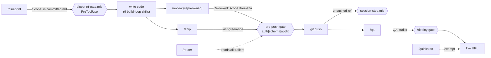

# Blueprint — SDLC chain (receipt-gated build loop + adopted build-loop skills)

Scope: .claude/skills/**, .claude/hooks/**, .claude/settings.json, .husky/pre-push, scripts/run-evals.mjs, scripts/lib/skill-*.mjs, evals/**, docs/decisions/ADR-064-sdlc-chain.md, docs/rules/harness.md, docs/build-vs-buy-ledger.md, package.json, scripts/ship.mjs, CLAUDE.md

## Problem & outcome

The template exists to build apps, but measured by SDLC phase it invests almost
nothing in building them. Skills bucketed by phase and weighted by depth:

| phase                | this template        | agent-skills   |
| -------------------- | -------------------- | -------------- |
| BUILD (write code)   | 7 skills / 758 lines | 5 / 1454       |
| VERIFY (test/debug)  | **1 / 79**           | 4 / 1262       |
| REVIEW               | **0 / 0**            | 4 / 1626       |
| QA/UAT               | 5 / 1049             | 0 / 0          |
| Evolve/Maintain      | 5 / 980              | 1 / 248        |
| **build loop total** | **837 lines**        | **4342 lines** |

Both endpoints of the lifecycle are automated — nothing to a provisioned live URL
in ~3 minutes (`/new-project`), finished app to IT handoff in five skills — and
the middle is improvisation. `/scaffold-entity` generates CRUD, then the operator
is on their own for slicing, testing, debugging and review.

Worse, the steps that do exist are not chained. Exactly **one** state token exists
in the repo (`.claude/state/last-green-sha`). `CLAUDE.md` declares the review rail
**binding** — _"before any push touching auth, schemas, API routes, or `lib/`, run
`/code-review` (blocking)"_ and _"after every code push invoke the
`senior-code-reviewer`"_ — and **no hook enforces either**. `/code-review` prints
findings to the transcript and leaves no artifact, so nothing downstream can know
whether it ran. That is a design defect, not a discipline defect: **a step whose
only output is transcript text cannot gate anything, and will be skipped.**

**Outcome:** the build loop gets both a process (nine skills) and a spine (three
receipts consumed by hard-deny gates), so skipping a step becomes a deliberate,
recorded act instead of an accidental, invisible one.

## Market scan

- **`addyosmani/agent-skills`** (MIT, v0.6.7, 24 skills) — the source of the nine
  adopted disciplines and of the Tier-2 routing-eval design. Rejected as a
  wholesale replacement: it is stack-agnostic prose with zero enforcement (3 hooks
  vs our 14), no UAT, no provisioning, no cross-session memory. Adopted per
  ADR-022's _built-not-imported_ convention — rewritten against our primitives,
  MIT attribution retained.
- **Anthropic skill-creator `evals.json`** — adopted as the behavioral-eval schema
  shape; Tier 3 itself deferred (token-expensive, and `/ship` + `/qa` + `/uat`
  already exercise real behavior against a real app).
- **Superpowers (obra)** — already the template's opt-in planning path
  (`.claude/settings.local.json.example`). Not duplicated here.
- **Build thin (rejected):** writing nine disciplines from scratch ignores a
  vetted MIT corpus and ADR-032's reuse-first scan.

## Feature parity

N/A — no `docs/benchmarks/` category exists for agent-harness/skills work (the
only benchmark is `enterprise-ui-and-app-skeleton.md`, a product category). No
parity matrix to disposition.

## Domain model

N/A — harness-only change; no entities, no schema, no migration. Precedent:
`docs/blueprints/browser-egress-bridge.md` (same shape: scripts + `.mcp.json` +
skills, no domain model). `project.config.json` retains `"pristine": true`, which
explicitly exempts the template from the ADR-031 db-structure check. No `dbAck`
needed.

## Universal app-floor checklist

N/A for every row — no list screens, no entities, no user-facing app surface.
This change ships skills, hooks and scripts only.

## Tier

`personal` (per `project.config.json`) — **but this is the template**, and the
chain lands **on by default for every fork** (decision 16). Fork inheritance is
treated like the security floor and the existing gate quartet: identical for
`personal` and `shared`.

## User stories

- **US1** — As the operator, I want each SDLC step to require the previous step's receipt, so I cannot skip review or QA by accident.
  - **AC-1.1** — WHEN a push contains changes under `lib/**`, `app/api/**`, `prisma/schema.prisma`, or auth files AND no commit in the push carries a `Reviewed: <scope> <tree-sha>` trailer whose tree-sha matches the current content of those paths, THE SYSTEM SHALL reject the push naming the unreviewed paths.
  - **AC-1.6** — IF a rebase, amend, or later edit changes the content of a reviewed path AFTER the trailer was written THEN THE SYSTEM SHALL treat the receipt as invalid (tree-sha mismatch) and re-demand review.
  - **AC-1.2** — WHEN a push contains only changes outside that scope, THE SYSTEM SHALL allow it without a review receipt.
  - **AC-1.3** — WHEN `/deploy` runs AND no commit at HEAD carries a `QA:` trailer, THE SYSTEM SHALL refuse to deploy and name `/qa` as the next step.
  - **AC-1.4** — WHEN `/quickstart` deploys, THE SYSTEM SHALL NOT require a QA receipt (the ~10-minute idea-to-URL path is preserved).
  - **AC-1.5** — IF a gate hook throws, fails to parse, or cannot evaluate a request THEN THE SYSTEM SHALL allow the operation (fail-open, per ADR-047's governance-gate split) and emit a warning naming the failed gate.

- **US2** — As the operator, I want a real process for the middle of the SDLC, so building is not improvisation.
  - **AC-2.1** — WHEN the operator asks to debug a failure, THE SYSTEM SHALL route to a repo-owned debugging skill rather than `/blueprint` (measured today: "the build is failing with a type error" ranks `blueprint` at 0.10).
  - **AC-2.2** — WHEN any adopted skill completes, THE SYSTEM SHALL present exit criteria that state what receipt, if any, the step writes.
  - **AC-2.3** — THE SYSTEM SHALL carry nine adopted skills rewritten against this repo's primitives (`npm run ship`, the `harness.md` known-traps, the five pillars, blueprint `Scope:` language), each retaining MIT attribution.

- **US3** — As the operator, I want to know which step I am on and what is blocking, so the process is legible from inside a session.
  - **AC-3.1** — WHEN the router skill is invoked, THE SYSTEM SHALL report the current step, the next step, and any missing receipt, derived from live git state.
  - **AC-3.2** — THE SYSTEM SHALL declare a position for every one of the 41 skills on either the lifecycle rail or the discipline rail (today: 7 of 32 have a station).

- **US4** — As the operator, I want to skip a gate deliberately when a hotfix demands it, without the skip becoming invisible.
  - **AC-4.1** — WHEN the operator records a skip acknowledgement, THE SYSTEM SHALL allow the gated operation and THE SYSTEM SHALL surface that skip in the next `/ship` run as unadjudicated.
  - **AC-4.2** — THE SYSTEM SHALL NOT provide an unrecorded bypass for the new gates (`--no-verify` remains git's own escape and is out of scope to remove).

- **US5** — As the template maintainer, I want skill routing measured, so adding nine skills does not silently break which skill fires.
  - **AC-5.1** — WHEN `npm run ship:full` runs, THE SYSTEM SHALL execute the Tier-2 routing eval and fail when the rank-1 rate falls below the ratchet.
  - **AC-5.2** — THE SYSTEM SHALL fail when any two skill descriptions exceed 75% cosine similarity (today: `design-qa` ↔ `design-system` at 59%, above the 50% warn line).
  - **AC-5.3** — WHEN the description pass completes, THE SYSTEM SHALL hold the mean skill description at or below 300 characters across all 41 skills (≈3,075 tokens always-on), i.e. below the 3,763-token starting point despite carrying nine more skills.

## Scenarios

- **US1-happy** — Given a change to `lib/services/foo.ts` reviewed via the new review skill, When the operator pushes, Then the pre-push gate finds the `Reviewed:` trailer and the push proceeds (AC-1.1).
- **US1-worst** — Given the same change with no review, When the operator pushes, Then the push is rejected naming `lib/services/foo.ts`, and **not** with a generic "gate failed" (AC-1.1). Given instead a corrupted receipt parser, When the operator pushes, Then the push succeeds with a warning rather than wedging the session (AC-1.5). Given a reviewed commit later rebased with conflict resolution, When the operator pushes, Then the tree-sha no longer matches and review is re-demanded rather than silently certified (AC-1.6).
- **US2-happy** — Given a failing typecheck, When the operator asks for help, Then the debugging skill routes first and its exit criteria require a root cause, not a guess (AC-2.1).
- **US2-worst** — Given an adopted skill whose generic advice is weaker than the ESLint floor (e.g. input validation), When it is applied, Then the house-style rewrite has already pinned it to `lib/validations/` + zod so the floor is not softened (AC-2.3).
- **US3-happy** — Given mid-feature work, When the router runs, Then it reports step, next step, and missing receipts from git (AC-3.1).
- **US3-worst** — Given a fresh container with no local state, When the router runs, Then it still answers correctly, because receipts are git trailers rather than gitignored files (AC-3.1, decision 13).
- **US4-happy** — Given a production hotfix, When the operator records the ack, Then the push proceeds and `/ship` reports the skip as unadjudicated (AC-4.1).
- **US4-worst** — Given an agent that wants past the gate, When it writes its own ack, Then the ack is committed and visible in git — the same agent-writable weakness `harness.md` documents for the quartet, accepted deliberately (AC-4.1).
- **US5-happy** — Given the nine new descriptions, When `ship:full` runs, Then routing rank-1 holds above the ratchet (AC-5.1).
- **US5-worst** — Given a new description that cannibalises `/ship`'s triggers, When `ship:full` runs, Then the collision check fails the gate before the description is merged (AC-5.2).

## Delta — was → now

| Surface                 | Was                               | Now                                                                | Who notices the break?                              |
| ----------------------- | --------------------------------- | ------------------------------------------------------------------ | --------------------------------------------------- |
| `.husky/pre-push`       | runs `npm run ship`               | also requires a content-bound `Reviewed:` trailer for scoped paths | anyone pushing auth/schema/route/lib changes        |
| `/deploy`               | deploys on demand                 | refuses without a `QA:` trailer at HEAD                            | operator deploying an unQA'd app                    |
| `/quickstart`           | idea → URL in ~10 min             | unchanged — explicitly exempt from the QA gate                     | nobody (deliberate carve-out)                       |
| 41 skill descriptions   | mean 470 chars, one 59% collision | tightened toward ~271 mean, collision resolved                     | routing changes for every skill; measured by AC-5.1 |
| `/ship`                 | 19 warm / 26 full checks          | `ship:full` gains the routing eval                                 | anyone running the full gate                        |
| `CLAUDE.md` review rail | prose, unenforced                 | prose + a mechanism that reads the receipt                         | anyone who was skipping it                          |

## Architecture sketch

**The mechanism:** a step emits a durable token; the next step's gate requires it.
Every link that already works in this repo has exactly that shape — `/blueprint`
emits a committed `Scope:` consumed by `blueprint-gate.mjs`; `/ship` emits
`last-green-sha` consumed by `.husky/pre-push`; a commit leaves an unpushed ref
consumed by `session-stop.mjs`. The three new links copy it.

**Receipts are git trailers** (decision 13), not `.claude/state` files: they travel
with the work, survive the ephemeral containers this repo runs in, need no
separate store, and add no branch churn. The trailer is **content-bound** (decision 17): it carries the tree hash of the
reviewed paths, `Reviewed: <scope> <tree-sha>`. A rebase or amend that changes
those paths changes the hash, so the gate detects the mismatch and re-demands
review instead of honouring a receipt for code nobody saw. This makes the receipt
self-verifying rather than self-asserting, and closes the staleness hole the
draft had accepted.

**Reuse, not duplication** (`docs/REPO-MAP.md` checked): the gates follow
`blueprint-gate.mjs`'s PreToolUse pattern and reuse `.claude/hooks/lib/path-match.mjs`
for scope globs; the review gate extends the existing `.husky/pre-push` rather than
adding a second git hook; the eval port reuses `scripts/lib/` and wires in beside
the existing `skill-check` in `ship:full`. No new runtime dependency (ADR-001
untouched); the eval runner is dependency-free.

## The five pillars

- **Speed** — description pass holds the always-on tax at ≤3,763 tokens for 41 skills (AC-5.3); receipts are read from `git log`, no extra I/O; eval is deferred to `ship:full`, not the warm loop.
- **Secure** — the security floor is untouched: no ESLint rule, auth wrapper, or zod boundary is modified. The new gates are governance-class and fail open on error per ADR-047 (AC-1.5); the review gate raises coverage of the highest-risk surface from prose to mechanism.
- **Maintainable** — reuses `path-match.mjs`, the existing pre-push hook, and the `blueprint-gate` pattern; adopted skills are rewritten to cite this repo's primitives so they cannot drift into generic advice that contradicts the floor.
- **Scalable** — the eval and gates are O(commits in push) and O(skills); no N+1, no unbounded scans. The chain adds links without adding state stores.
- **High-Quality** — nine skills each ship a Verification section, which is also the spec for the receipt they emit; routing is measured rather than assumed.

## Open questions (resolved)

- [x] Gate strength on a missing receipt → **hard-deny**
- [x] Test-before-code → **skill only, no gate** (`/cover` stays the coverage-floor helper)
- [x] Adoption style → **rewrite in house style**, MIT attribution retained (aligns ADR-022)
- [x] Wave scope → **all three layers at once** (operator overrode the vertical-slice recommendation; mitigated by per-link backout below)
- [x] Review gate scope → **auth · schemas · `app/api/**` · `lib/**`** (CLAUDE.md's existing wording)
- [x] QA gate → **gates `/deploy`, exempts `/quickstart`**
- [x] Tier-2 evals → **in this wave**
- [x] Skills adopted → **nine** (all four borderline included)
- [x] Bypass → **recorded ack**, `tierAck`/`complexityAck` convention
- [x] Descriptions → **tighten all 41**
- [x] Router → **skill reading live receipt state**
- [x] browser-testing → **retargeted to Playwright MCP, build-time debugging only**; `/design-qa` + `/manual-uat` keep the audit role
- [x] Receipt durability → **git trailer on the commit**
- [x] Hook error behavior → **fail open** (ADR-047 governance split preserved)
- [x] Ask-before on hooks/settings.json → **approved in this blueprint's Scope**
- [x] Fork inheritance → **on by default**, like the security floor and the quartet
- [x] Review skill name → **`/review`** (avoids shadowing the plugin `/code-review`, which stays available as the raw diff-reader underneath)
- [x] Trailer staleness → **bind the trailer to a tree hash** of the reviewed paths; a rebase invalidates it (AC-1.6)
- [x] Wave shape → **all-at-once confirmed** after seeing the 7-task DAG; per-link backout is the mitigation
- [x] Sign-off → **signed with these four folded in** (Amendments below)
- [x] Description budget → **rescaled to a per-skill target** (≤300 char mean over 41 skills) rather than a 32-skill absolute
- [x] Push posture during a wave → **hold for one combined green push**; the single `/ship` is the only run that means anything
- [x] Wave 2 width → **wide**: four chunks of task 3 plus task 6, five units

## Work DAG

| #   | Task (cites its story)                                                           | P/S           | File-ownership set                                                                                                                                                                                                                          | Role-lens    |
| --- | -------------------------------------------------------------------------------- | ------------- | ------------------------------------------------------------------------------------------------------------------------------------------------------------------------------------------------------------------------------------------- | ------------ |
| 1   | Port Tier-2 routing eval + cases; wire into `ship:full` — US5                    | [P]           | `scripts/run-evals.mjs`, `scripts/lib/skill-*.mjs`, `evals/**`, `package.json`, `scripts/ship.mjs`                                                                                                                                          | infra        |
| 2   | Rewrite 9 adopted skills in house style — US2/AC-2.3                             | [P]           | `.claude/skills/{test-driven-development,debugging-and-error-recovery,incremental-implementation,review,api-and-interface-design,observability-and-instrumentation,doubt-driven-development,browser-debugging,performance-optimization}/**` | api + ui     |
| 3   | Verification sections on the existing 32 — US2/AC-2.2                            | [S] after 2   | `.claude/skills/*/SKILL.md` (existing 32 only)                                                                                                                                                                                              | infra        |
| 4   | Description tightening pass, all 41 — US5/AC-5.2,5.3                             | [S] after 2,3 | same as 3 + the 9 from 2                                                                                                                                                                                                                    | infra        |
| 5   | Three receipt gates + ack path — US1/US4                                         | [P]           | `.claude/hooks/**`, `.claude/settings.json`, `.husky/pre-push`                                                                                                                                                                              | auth + infra |
| 6   | Router skill — US3                                                               | [S] after 5   | `.claude/skills/router/**`                                                                                                                                                                                                                  | infra        |
| 7   | ADR-064 + `harness.md` chain table + build-vs-buy ledger entry + CLAUDE.md rails | [S] after 5,6 | `docs/decisions/ADR-064-sdlc-chain.md`, `docs/rules/harness.md`, `docs/build-vs-buy-ledger.md`, `CLAUDE.md`                                                                                                                                 | infra        |

| 8 | Surface unadjudicated `Gate-Skip:` trailers in `/ship` — US4/AC-4.1 | [S] after 5 | `scripts/ship.mjs` | infra |
| 9 | Decide whether `evals` moves from `fullOnly` to the warm loop — US5/AC-5.1 | [S] after 1 | `scripts/ship.mjs` | infra |

Tasks 1, 2 and 5 are write-disjoint and form the first parallel group (`/fan-out`
`check-overlap` verifies before dispatch, `verify-scope` after). Tasks 3 and 4 both
write `.claude/skills/*/SKILL.md` and therefore **cannot** be a `[P]` pair —
serialized deliberately.

**Per-link backout** (the mitigation for landing all three layers at once): each
gate is a separate hook file with a separate `settings.json` entry, so any one link
can be disabled by removing its entry without touching the others or the skills.

## Amendments

Confirmed: <pending re-sign — amendments below>

| Date       | Section                            | Was                                     | Now                                                       | Reason                                                                                                                                                                                                                                                   |
| ---------- | ---------------------------------- | --------------------------------------- | --------------------------------------------------------- | -------------------------------------------------------------------------------------------------------------------------------------------------------------------------------------------------------------------------------------------------------- |
| 2026-08-22 | Architecture / AC-1.1              | `Reviewed:` trailer, staleness accepted | `Reviewed: <scope> <tree-sha>`, content-bound; new AC-1.6 | A rebase resolving conflicts preserved the message while changing the code, so the receipt could certify unreviewed content. Binding to a tree hash makes it self-verifying.                                                                             |
| 2026-08-22 | Work DAG / diagram                 | skill named `code-review`               | skill named `review`                                      | `code-review` is already provided by a plugin; a same-named project skill would silently shadow it and would likely trip the Tier-2 collision check (AC-5.2).                                                                                            |
| 2026-08-22 | Wave shape                         | all-at-once (chosen pre-DAG)            | all-at-once (re-confirmed post-DAG)                       | Operator reviewed the 7-task decomposition and kept the shape; per-link backout stands as the mitigation.                                                                                                                                                |
| 2026-08-22 | Sign-off                           | pending                                 | signed                                                    | Operator sign-off with the three decisions above folded in.                                                                                                                                                                                              |
| 2026-08-22 | AC-5.3                             | hold 3,763 tokens absolute              | ≤300 char mean over 41 skills (≈3,075)                    | The 3,763 figure was measured at 32 skills; holding a 32-skill absolute over 41 forces the whole cut onto the existing 32 and does not scale as the catalogue grows.                                                                                     |
| 2026-08-22 | Architecture / `/review`           | hash algorithm restated in prose        | skill calls the `receipt.mjs` CLI                         | Two implementations of one invariant drift. `receipt.mjs` is now the single source, so emitter and verifier share code and cannot disagree.                                                                                                              |
| 2026-08-22 | Work DAG                           | 7 tasks                                 | 9 tasks (added 8, 9)                                      | Wave 1 surfaced two gaps: AC-4.1 is incomplete without `/ship` reporting `Gate-Skip:` trailers, and `evals` runs only in `ship:full`, so the warm pre-push gate never exercises it.                                                                      |
| 2026-08-22 | Implementation note (no AC change) | —                                       | `receipt.mjs` empty-tree defect fixed                     | A bare directory scope silently hashed to the empty tree, so a receipt could certify zero files and still verify. Fixed on both ref and working-tree paths; emission now refuses an empty scope. Recorded because it nearly made the receipt decorative. |
