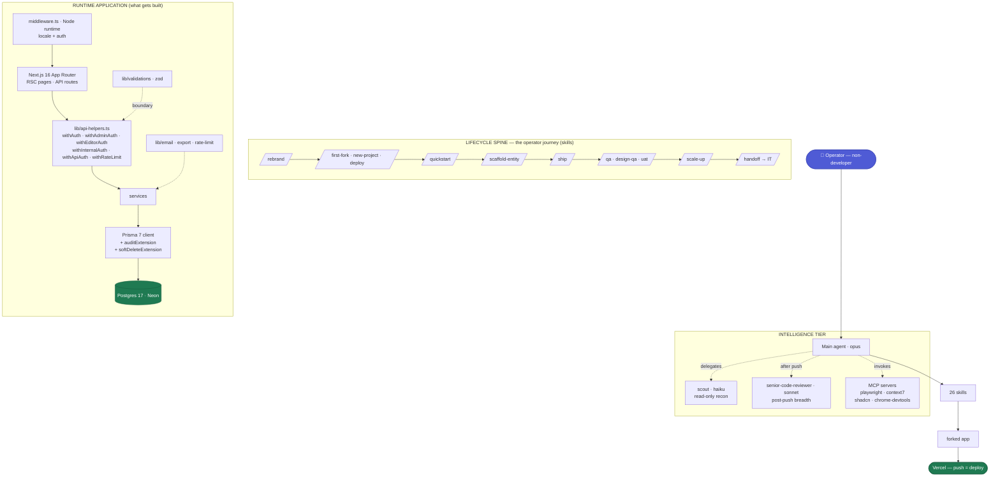
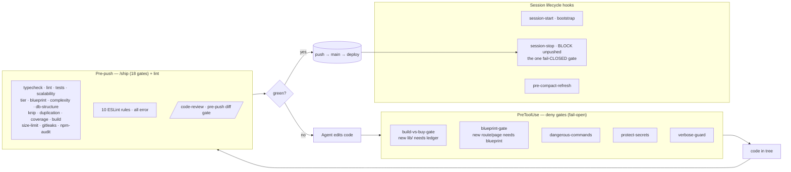

# Repo Objectives & Architecture

_Derived from the tools the repo actually ships (see `docs/harness-inventory.md`). This is the map to reason against when improving the template._

## What this repo is

A **prototype rail**: a reusable Next.js starter that lets a _non-developer operator_ turn an idea into a **secure, quality, shareable live URL** by iterating with Claude — then hand production to an IT team. It is two products in one repo:

1. **A runtime application template** — the Next.js + Prisma + Auth.js app that gets forked and shipped.
2. **A harness (an AI-development operating system)** — the skills, hooks, agents, gates, and governance in `.claude/` + `scripts/` + `docs/` that make Claude's default behavior _match the standard automatically_, instead of relying on the operator to know the rules.

The second is the point. The whole repo exists so that "good practice" is **enforced by the machine**, not remembered by a human.

## Objectives (what the tooling optimizes for)

Each objective is inferred from the tools built to serve it:

| #      | Objective                                                                                                         | The tools that serve it                                                                                                                                            |
| ------ | ----------------------------------------------------------------------------------------------------------------- | ------------------------------------------------------------------------------------------------------------------------------------------------------------------ |
| **O1** | **Idea → shared live URL, fast** (~10 min, non-dev friendly)                                                      | `/quickstart`, `/scaffold-entity`, `/new-project`, `/first-fork`, `/deploy`; Vercel + Neon (ADR-006); push = deploy                                                |
| **O2** | **A security floor that never bends** — even a throwaway is secure-by-default                                     | 10 ESLint rules · auth wrappers (`api-helpers`) · audit + soft-delete Prisma extensions · zod boundaries · `protect-secrets`/`dangerous-commands` hooks · gitleaks |
| **O3** | **Quality enforced as gates, not hoped for** — the Five Pillars (speed/secure/maintainable/scalable/high-quality) | `/ship` (18 gates) · `/qa` → `/design-qa` → `/uat` · `findings-register` wave-offs                                                                                 |
| **O4** | **Enforcement over advice** — convert good-practice prose into machine checkpoints                                | build-vs-buy gate (ADR-032) · blueprint gate (ADR-033) · complexity gate (ADR-034) · tiered gates (ADR-025)                                                        |
| **O5** | **Cost discipline / token thrift** — the operator iterates cheaply                                                | `scout` (haiku) · `verbose-guard` · model-routing (ADR-022) · `/batch`                                                                                             |
| **O6** | **Cross-session durability** — ephemeral containers never lose work                                               | `session-stop` hook (hard-block on unpushed) · `/handoff-session` · `agent-memory` · `pre-compact-refresh`                                                         |
| **O7** | **Design quality on the first pass** — non-slop UI without a designer                                             | `/design-system` · shadcn/Radix primitives · `tokens.css` · `no-raw-hex-color` · `uat-rubric`                                                                      |
| **O8** | **Graceful growth + clean exit** — prototype → production without restructuring                                   | `/scale-up` recipes · `/handoff` (to IT) · `/conform` · `/sync-from-template`                                                                                      |

**One sentence:** _make it trivially easy to ship a secure, well-built internal tool, and structurally hard to ship a bad one._

---

## Architecture — the five layers

The repo is best understood as five layers. The **operator** drives the top; everything below either _produces_ the runtime app or _guards_ its production.

### Layer 1 — Lifecycle spine (skills)

The horizontal operator journey: **rebrand → provision → quickstart → scaffold → ship → QA → scale-up → handoff.** Skills are the verbs. ~7 carry a hard internal gate (`/ship`, `/handoff`, `/design-qa`, `/qa`, `/uat`, `/scaffold-entity`, `/conform`); the other ~19 are advisory (invoke-when-you-remember), nudged only by the `skill-activation` hook.

### Layer 2 — Runtime application (the product)

The strict call chain, enforced by lint rules:

`Request → middleware.ts (auth/locale) → App Router (RSC page OR API route) → api-helpers wrapper → service → Prisma (audit + soft-delete) → Postgres`

Invariants (each backed by an ESLint rule and/or a lib primitive):

- **UI never touches Prisma** (`no-prisma-in-client`) — only RSC + API routes do.
- **Every route is auth-wrapped** (`api-helpers`; `no-bare-internal-route`).
- **Rate-limit composes _outside_ auth** (`no-rate-limit-inside-auth`).
- **zod validates at the boundary** before Prisma.
- **Audit + soft-delete are automatic** via Prisma extensions (`prismaUnfiltered` bypasses both — allowlisted).
- **No raw/unsafe SQL, no secret logging, no off-token colors, no unaudited bulk writes, no secret export columns** (the remaining rules).

### Layer 3 — Enforcement mesh (the guards that wrap everything)

This is the layer that makes objectives O2–O4 real. It wraps _both_ the agent's actions and the code's push path.

**The honest caveat** (from the audit): every PreToolUse guard is **fail-open** — if the hook errors, the action is allowed. Only `session-stop` fails closed. And the three new gates fire on **added files only**, blind to `Edit`-driven sprawl. These are the top improvement targets for this session.

### Layer 4 — Intelligence tier (who does the work)

- **Main agent (opus)** — drives everything.
- **scout (haiku)** — cheap read-only recon; keeps big reads out of the expensive window (O5).
- **senior-code-reviewer (sonnet)** — post-push breadth review (dormant in CI until funded → currently invoke-on-demand).
- **MCP servers** — `playwright` (drives `/design-qa` `/uat`), `context7` (live docs), `shadcn` (component scaffolding for the current stack), `chrome-devtools` (perf; not yet wired to a skill).

### Layer 5 — Knowledge & governance (the rules of record)

The layer everything else answers to — read at SessionStart, enforced by the gates:

`CLAUDE.md` (binding rules) · **34 ADRs** (decisions of record; 5 are enforcement gates) · `SECURITY.md` (data classes, threat model) · `uat-rubric.md` (the Five Pillars) · `token-policy.md` (O5) · `agent-memory.md` (durable cross-session knowledge, O6) · `findings-register.md` (adjudicated wave-offs) · `build-vs-buy-ledger.md` + `docs/blueprints/*` (the artifacts the new gates check for).

---

## How a single change flows through all five layers

1. Operator prompts the **main agent** → the prompt passes `UserPromptSubmit` hooks (`skill-activation` suggests). _(L4 + L3)_
2. Agent picks a **skill** from the lifecycle spine (e.g. `/scaffold-entity`), possibly delegating recon to **scout**. _(L1 + L4)_
3. Agent writes code → each tool call passes **PreToolUse deny gates** (build-vs-buy, blueprint, etc.). _(L3)_
4. Code lands in the **runtime app** along the enforced call chain, satisfying the **ESLint invariants**. _(L2)_
5. Before push: **`/code-review`** then **`/ship` (18 gates)** must be green; the change is judged against the **Five Pillars** in `uat-rubric`. _(L3 + L5)_
6. Push → Vercel deploys; **`senior-code-reviewer`** does the breadth pass. _(L4)_
7. **`session-stop`** blocks the turn from ending with unpushed work; durable knowledge goes to **`agent-memory`**. _(L3 + L5 + O6)_

Every arrow is governed by **CLAUDE.md + the ADRs** (L5). That is the whole machine.
